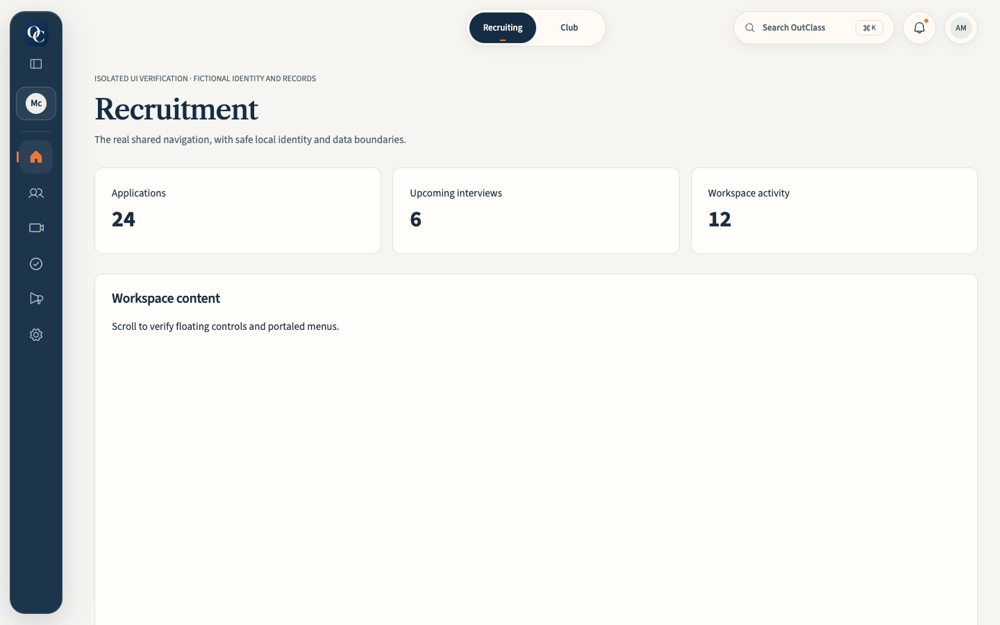
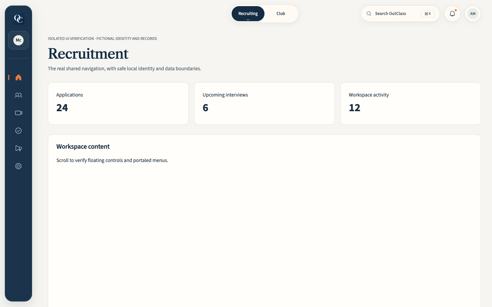
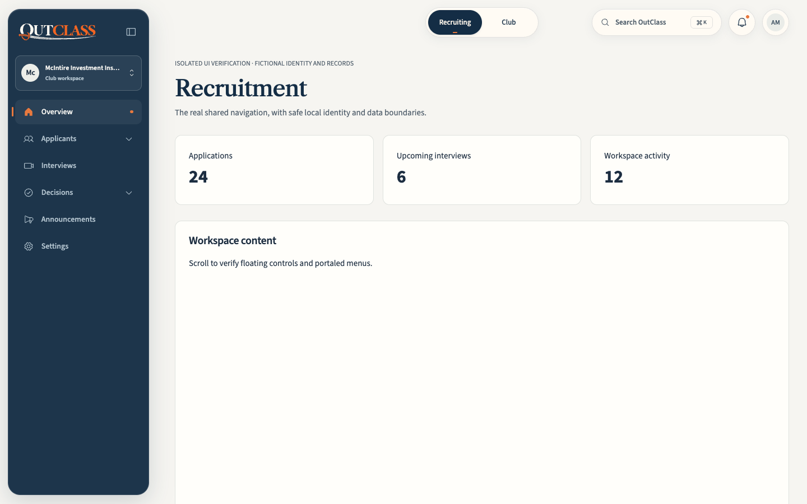
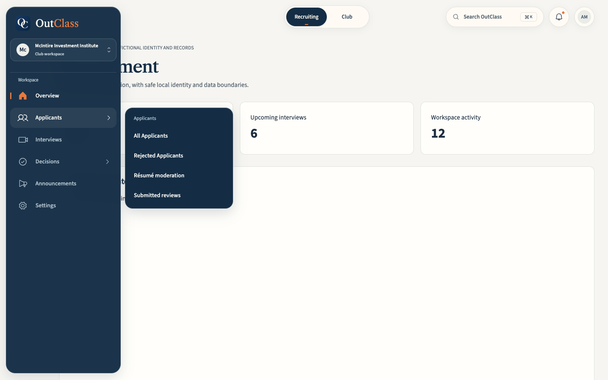
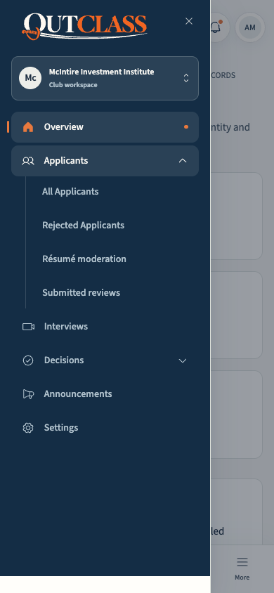

# Premium expanding dock V2

## Audit and scope

The baseline is [PR #67](https://github.com/TheFrtiz22/out-class/pull/67), merged as `f1ac91a`, on top of the current `main` (`1e87dd1`). Its manual toggle changed the shell-width token, persisted a browser preference, and rendered grouped destinations inline. Its tooltip/icon treatment applied only when compact. The new presentation uses the [Framer expanding dock](https://www.framer.com/marketplace/components/expanding-dock/) as interaction inspiration; no Framer code or new dependency is included.

The audit covered `product-shell.tsx`, `floating-dock.css`, `workspace-navigation.tsx`, `authenticated-product.css`, `floating-header.css`, `lib/product-navigation.ts`, the workspace switcher, route callbacks, navigation tests, and the real-shell browser harness. Existing boundaries:

- Desktop begins at 1024 CSS px. Below that, the labeled mobile drawer and bottom bar remain in place.
- Recruiting has Overview, Applicants, Interviews, Decisions, Announcements, and Settings, filtered before rendering. Applicants/Decisions children use `navGroup` metadata. Explicit interview offices still govern résumé moderation and submitted reviews; ownership does not imply those offices.
- Club management retains its Overview, Meetings, Tasks, Members, Announcements, and Settings destinations. Personal workspaces retain Home, Explore/Apply/My Clubs context, Calendar, Notifications, Profile, and Settings.
- Platform administration retains the Home, Platform, Operations, and System sections and internal overflow scrolling.
- `ProductShell` still owns `canLeaveWorkspace`, query-only `handleClubLink`, mode callbacks, search, notifications, account actions, and content focus on route changes. `ClubWorkspaceSwitcher` retains its existing eligibility read, membership filtering, settings-aware routing, and leave guard.

## Architecture

`ExpandingDock` owns desktop interaction state, so hover does not rerender the dashboard or remount its providers. It receives the existing filtered metadata and the shell's link renderer. The existing `WorkspaceNavigation` continues to render mobile disclosures.

- The rail starts at 80px and expands to 272px on hover or focus. The shell always reserves 108px (including the floating inset); neither main content nor header controls change bounds on expansion.
- Expansion takes 300ms with the existing sampled spring and an easing fallback. Labels fade and translate subtly. Icon **wrappers**, rather than SVG paths, transform to 1.17×, with neighbors at 1.065×; targets stay 48px tall.
- One highlight lives in the scrolling navigation canvas. Discrete item/focus events position it. A single ResizeObserver handles canvas geometry changes; there is no pointer-move state, polling, or continuous custom animation loop.
- One group is open at a time. Existing Radix Popover handles portals, collision boundaries, outside dismissal, and ARIA disclosure linkage. Its navy flyout is 10px from the expanded surface, with a transparent hover bridge and a shared 200ms exit delay. It never depends on overflow-visible scrolling.
- The exit delay is canceled on reentry. Pointer presence, dock/flyout focus, and the workspace dropdown keep the rail open. Workspace menu state is controlled only for the desktop instance; mobile consumers retain the original uncontrolled interface.
- Keyboard users can Tab into the rail, open groups with Enter/Space or directional keys, traverse destinations with arrows/Home/End/Tab, return with Escape/Left, and use a second Escape to focus page content and collapse. Tab exits the flyout at either end; it never traps focus. Reopening an interrupted Radix entrance retains correct destination focus. Successful navigation focuses content, rather than returning focus to the old group.
- Crossing the desktop breakpoint dismisses desktop portals and returns hidden dock focus to content. Touch laptop users open groups by tapping. Reduced motion removes decorative animations/magnification. Forced colors preserves a visible outline and active marker.
- The same monogram remains mounted in both states, avoiding an artwork request on expansion. Browser assertions verify zero additional requests, stable content bounds, and retained main-content identity.
- The rail remains below the floating header and modal overlay. Portaled flyouts use z-index 45, below dialog content (50) and existing utility dropdowns (60). A small fixed header inset at 1024–1439px leaves mode controls accessible while expanded.

No database, action, authentication, authorization policy, API contract, or dependency changes are required.

## Changed files

| File | Purpose |
| --- | --- |
| `components/shell/expanding-dock.tsx` | Desktop interaction, shared highlight, grouped flyouts, focus and dismissal |
| `components/shell/product-shell.tsx` | Reuse shell link callbacks and filtered sections; keep search shortcuts available from nonmodal dock flyouts |
| `components/shell/floating-dock.css` | Compact/expanded surface, labels, icon transforms, flyouts, motion and contrast modes |
| `components/shell/floating-header.css` | Constant room for overlay at smaller desktop widths |
| `components/club-workspace-switcher.tsx` | Optional controlled opening so desktop dropdown lifecycle holds the rail open |
| `styles/product-components.css` | Exempt the navy dock flyout from the generic ivory popover surface rule |
| `tests/expanding-dock-browser.test.cjs` | Real-shell interaction, accessibility, and responsive regression suite |
| `tests/helpers/expanding-dock-browser.cjs` | Isolated local server using real shell, Radix, styles, fonts, and route adapters |
| `tests/fixtures/floating-header/{app,boundaries}.jsx` | Actual student/admin metadata and explicit fictional interview-office grants |
| `scripts/check-floating-header.cjs` | Updated dock assertions and current accessible control names; local fonts independent of build output |

## Verification

The story is: a permitted destination enters the real shared shell, is presented in the dock or mobile drawer, passes the existing leave guard, then updates the route and focuses retained page content. The fixture isolates identity/data boundaries; no production records, groups, decisions, messages, sessions, or database state are changed.

Run:

```sh
npm run typecheck
npm run lint
node --test tests/product-shell-focus.test.cjs tests/personal-workspace.test.cjs tests/navigation-refinement.test.cjs tests/workspace-navigation.test.cjs tests/applicant-interview-navigation.test.cjs tests/auth-navigation.test.cjs tests/settings-navigation.test.cjs tests/notification-center.test.cjs tests/journey-navigation.test.cjs
node --test tests/navigation-refinement-browser.test.cjs tests/applicant-review-navigation-browser.test.cjs tests/floating-search-browser.test.cjs
node --test tests/expanding-dock-browser.test.cjs
OUTCLASS_NAV_BROWSER=webkit node --test tests/expanding-dock-browser.test.cjs
node scripts/check-floating-header.cjs
npm run build
```

To refresh the after screenshots, set `OUTCLASS_DOCK_SCREENSHOTS=docs/expanding-dock-v2` on the Chrome dock test. The before screenshots were captured from the baseline implementation before changing its code.

The new suite checks collapsed/expanded bounds; readable labels; central and neighbor magnification; one moving highlight; slow gap traversal; group switching; rapid reentry; delayed collapse; pointer/focus retention; guarded and successful destinations; Back/Forward; keyboard opening, reopening, traversal, dismissal, and route focus; global search; workspace switching; explicit office/owner/reviewer/settings permissions; all personal modes; all admin sections; internal scrolling; touch; reduced motion; forced colors; and Axe accessibility scans on the open desktop flyout and mobile drawer.

Desktop sizes: 1024, 1280, 1440, and 1920px. Short desktop viewport: 1024×420. Mobile: 390 and 320px. The 720px CSS viewport covers the responsive state of a 1440px display at 200% browser zoom. Live authenticated server data is outside this presentation-only fixture's coverage; existing server contracts are unchanged.

## Screenshots

| State | Before | After |
| --- | --- | --- |
| Compact desktop |  |  |
| Expanded desktop |  |  |



Recorded results for this implementation:

- TypeScript and the production build passed.
- Repository-wide ESLint passed with 0 errors and 26 existing hook-dependency warnings. The three edited production TSX components have no lint warnings.
- All 67 focused regression tests passed, with no skips.
- Four existing browser flows passed, with no skips.
- The complete new dock suite passed in both Chrome and WebKit, including desktop/mobile Axe scans with no violations.
- The shared floating-header harness passed all existing search, notification, account, permission-role, mobile, history, and logout scenarios.

There are no known outstanding dock issues. Backend checks remain covered by existing contracts and server tests; the screenshots and browser tests intentionally use fictional identities and isolated data boundaries.
