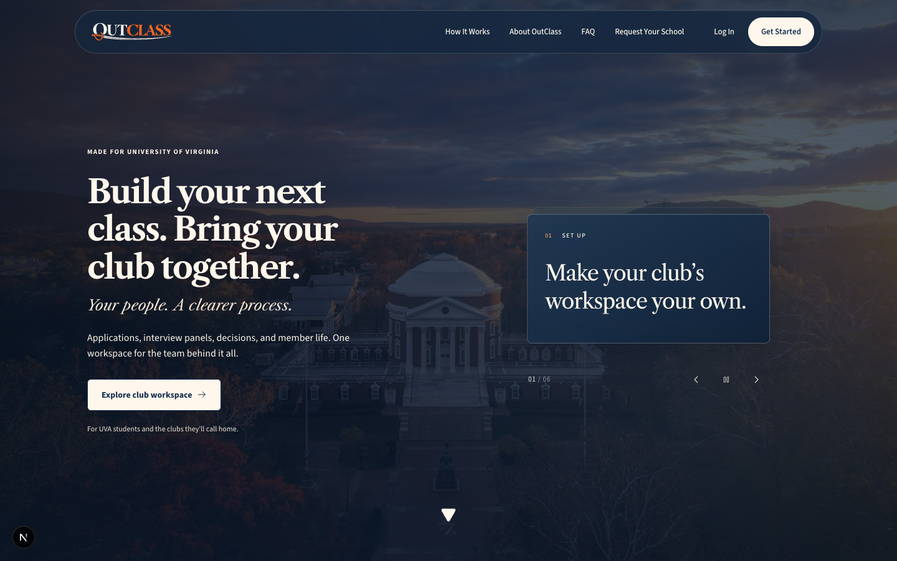
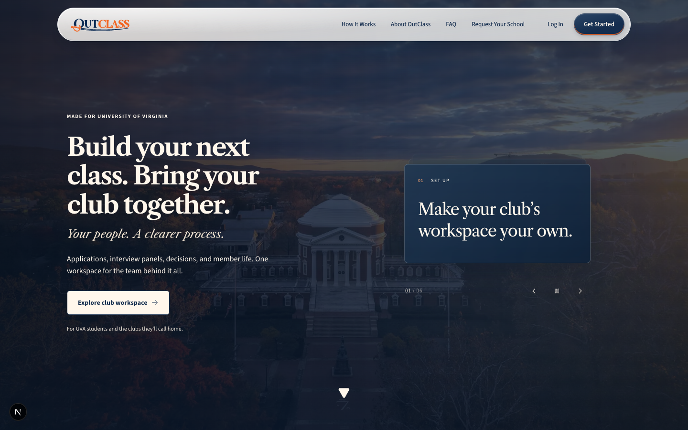
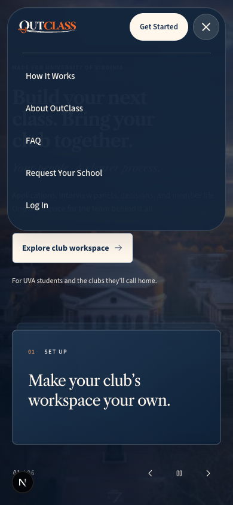
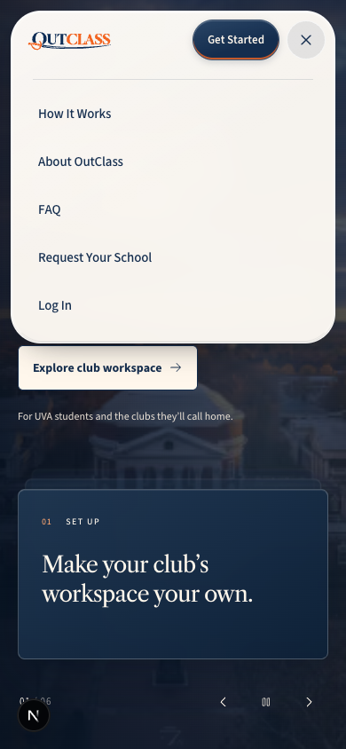
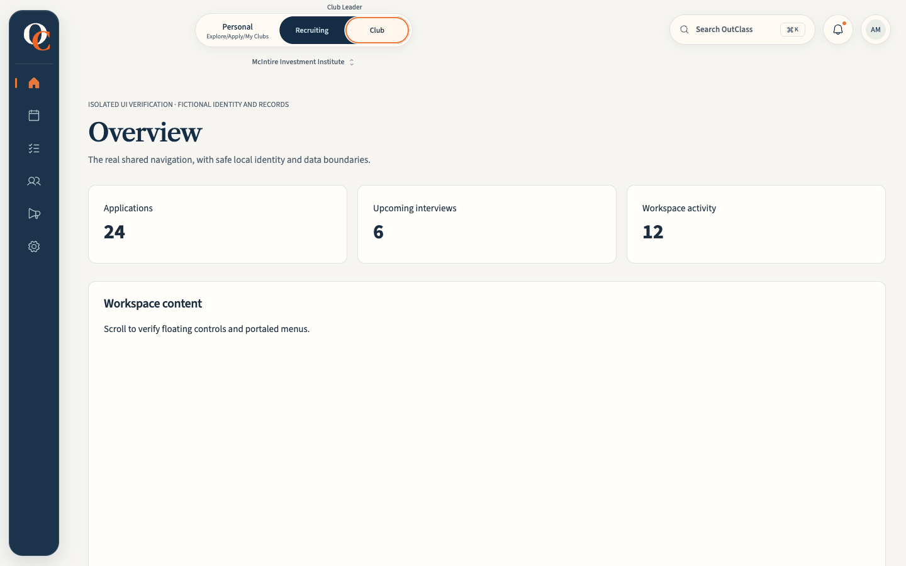
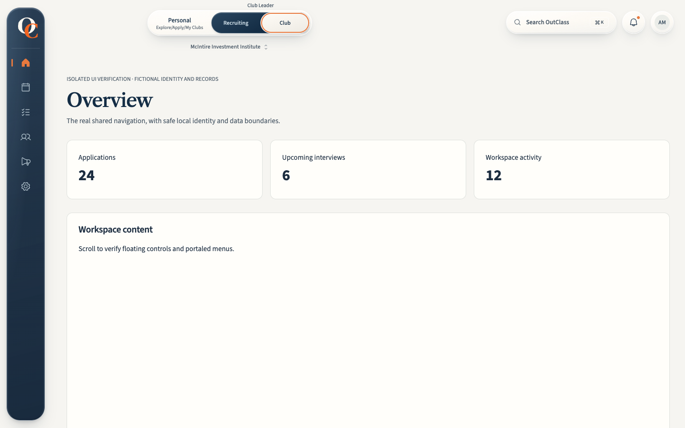
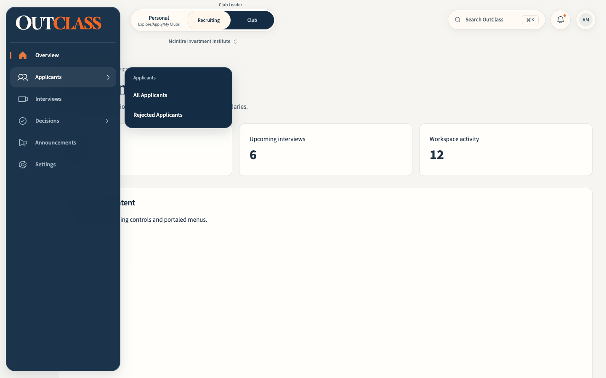
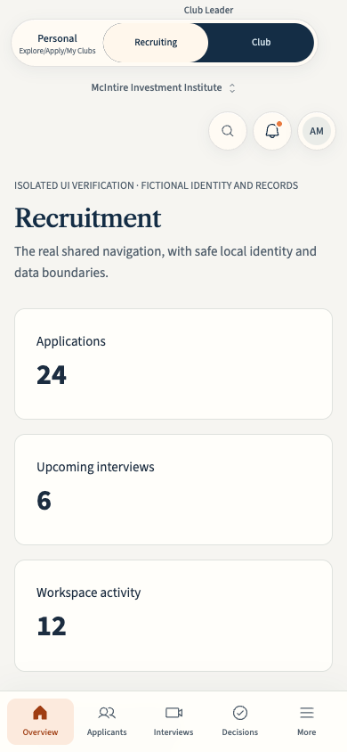
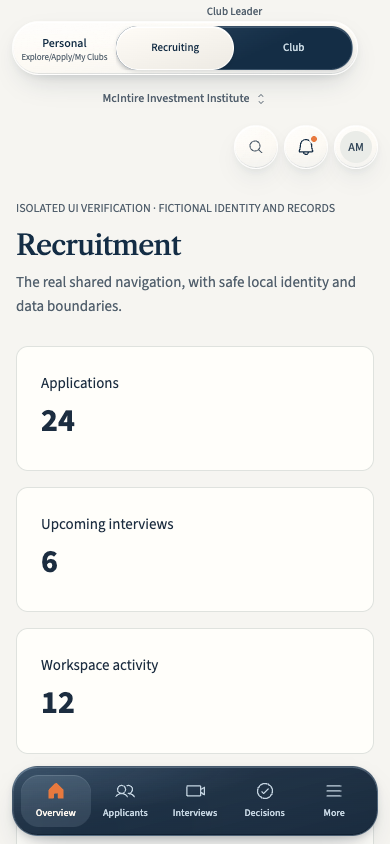

# OutClass navigation glass

The public capsule, navy expanding dock, mobile navigation and navigation popovers share a small CSS material system. Routing, workspace eligibility, permission filtering, leave guards and the mounted dock items remain with their existing owners.

## Baseline and references

The feature is based on main at `145fed90e046fe11577c86654c5f29ff6964f177`. The initial local branch was behind main; baseline evidence was refreshed against main's actual expanding dock before implementation.

- [Apple Liquid Glass](https://developer.apple.com/documentation/technologyoverviews/liquid-glass): navigation sits on a separate optical layer, with continuous shapes and restrained interaction feedback.
- [Apple Materials](https://developer.apple.com/design/human-interface-guidelines/materials): readable text requires thicker material, and glass belongs primarily to navigation and transient controls.
- [Framer component](https://www.framer.com/marketplace/components/liquid-glass-navbar/) and [live preview](https://liquid-glass-navbar.framer.website/): studied rendered edge thickness, capsule lighting, hover response and responsive disclosure. No reference assets, component source or proprietary effects are included.

The external component is `components/landing/public-navigation.tsx`, shared by the landing and secondary information pages. `LandingNavigation` handles existing fragment navigation separately. The external header keeps its 32px scroll threshold, native destinations, active fragments, perspective handoff and disclosure dismissal. The material stays light on the dark hero and subsequent light/navy sections; the navy-on-cream brand variant provides consistent contrast.

The internal dock remains 80px collapsed / 272px expanded, with 108px reserved for content. Hover/focus expands the same rail. Group flyouts retain Radix positioning, the pointer bridge, diagonal intent delay, keyboard traversal and two-stage Escape. The header retains Personal / Club Leader / Admin segmentation, club selection, search shortcuts, notifications and account actions. Desktop begins at 1024px; mobile retains its drawer and five existing primary destinations.

## Material and motion

`styles/navigation-glass.css` defines shared directional reflections, edge colors, shadow depth, blur and motion tokens. Solid backgrounds are the default. A feature query enhances supported browsers with 18px light diffusion and 16px navy diffusion. Light surfaces admit environmental color; navy surfaces use a denser tint. Text-heavy flyouts and utility menus use 96–97% base tint to prevent overlapping text from competing.

Fine inset highlights and an inner rim describe thickness without a glow. Background gradients are stationary and resize naturally with the dock. There are no SVG displacement filters, cursor-tracking lights, continuous animation loops or new packages. Actual background refraction was omitted because an additional filtered layer would add cost and browser variability without helping navigation. Text and icons are never distorted.

Dock width and brand movement share a 360ms transition and the existing sampled spring, with a cubic-bezier fallback. One moving hover highlight remains in the scrolling rail. Magnification tapers from 1.17× to 1.065× and 1.02× across two adjacent rows, using discrete existing item events and CSS interpolation; layout and hit targets stay fixed. Active orange markers remain separate from hover illumination. The original vector monogram and orange C remain mounted.

The mobile public drawer now grows within one material surface. Its header retains a 90px footprint, including on sticky information pages, so opening the disclosure does not push page content. This also removes nested backdrop sampling and the background-text bleed found during the first pass.

Reduced motion removes decorative movement; reduced transparency and increased contrast select solid materials without blur. Forced colors retains boundaries, selected states and visible focus. The generic product popover rule excludes only the named navigation surfaces. Operational cards, forms and dialogs retain their existing materials.

## Screenshot refinement

Baseline, pass 1 and final captures cover 1440×900, 1280×800, 1024×768, 768×1024 and 390×844. Each set includes the public hero, light journey and dark footer, mobile disclosures, collapsed/expanded/hovered/focused dock states, flyouts, workspace selection, search, notifications, account menu and increased contrast.

Pass 1 established the shared optical layers and related light/navy surfaces. Review found a visible seam and background text in the public mobile drawer, and a slightly washed-out navy tint. Pass 2 combined the drawer's backdrop, deepened the navy base, and added a fine inner rim. Final images were inspected for clipping, alignment, stacking, text interference and contrast. Representative before/after files are in `screenshots/`; the complete reproducible audit output lives under ignored `test-results/liquid-glass/`.

Pre-merge review caught one additional tablet state: with the perspective control merged into the header, opening the drawer moved that control down with the growing surface. The header row now establishes its containing block. The browser regression reproduces the original 127.5px displacement at 768px and checks stable row alignment through opening and dismissal at 768px, 1024px and 1099px.

| Surface | Before | After |
| --- | --- | --- |
| Public capsule over the hero |  |  |
| Public mobile disclosure |  |  |
| Collapsed dock |  |  |
| Expanded dock and flyout |  |  |
| Internal mobile navigation |  |  |

## Verification

The tested story is: an authorized destination enters the existing shell, opens the dock/flyout or mobile drawer, passes the existing leave guard, changes the route and focuses retained content. Public checks exercise actual local Next routes. Internal browser tests render the real ProductShell, Radix components, CSS and fonts with fictional identities and local data boundaries. No production identities or records are used.

Evidence includes 79 navigation regression tests; dock/workspace selector browser suites in Chrome and WebKit; four additional navigation/search browser tests; public destination, scroll, focus and disclosure checks; automated WCAG 2.2 AA scans of navigation and open utility surfaces; TypeScript, ESLint and an optimized production build. ESLint has 22 pre-existing warnings and no errors. Tests cover owner, president with explicit interview offices, reviewer, settings-only, student, member and platform users, including delayed eligibility, revocation, failed eligibility, leave guards, touch, forced colors and reduced motion. New assertions verify the orange C before/after expansion and opaque fallback behavior.

One Chrome diagonal-pointer assertion timed out while the production build and both browser engines ran concurrently. The same final dock suite passed when rerun by itself; its intent delay and pointer bridge were not changed. This timing-sensitive suite should run apart from CPU-heavy build work. Validation logs are retained in `evidence/`.

The native database CI jobs authenticate public container pulls with the built-in, ephemeral `GITHUB_TOKEN`, scoped to `contents: read` and `packages: read` only on those jobs. This follows [GitHub's registry authentication guidance](https://docs.github.com/en/packages/working-with-a-github-packages-registry/working-with-the-container-registry) and avoids relying on anonymous pulls after repeated registry throttling blocked tests before execution. Pinned image digests and test commands are unchanged; no stored secrets or production credentials were added.

The isolated server intentionally has no production auth/database/mail connection. Public build/runtime reads therefore use the application's existing unavailable-data fallback. Real authenticated database integration is outside this visual change; existing authorization code is unchanged.

### Performance observations

Local synthetic Chrome samples show no material frame-time or memory regression. These are short, warm fixture runs on this workstation, not field INP or physical-device benchmarks. The same pre-change fixture was kept running for comparison; three fresh contexts were measured per viewport without Axe overhead. Full samples are in `performance-comparison.json`.

| Measurement | Before | After |
| --- | ---: | ---: |
| Public desktop scroll p95 (132 frames) | 16.7ms | 16.8ms |
| Dock desktop scroll p95, median of 3 runs | 17.5ms | 17.1ms |
| Dock hover p95, median of 3 runs | 17.6ms | 17.4ms |
| Mobile shell scroll p95, median of 3 runs | 17.6ms | 17.3ms |
| Desktop settled JS heap after forced GC | 9.90–9.91MiB | 9.94MiB |
| Mobile settled JS heap after forced GC | 7.89–7.90MiB | 7.89–7.90MiB |
| Navigation layout shifts in scroll audit | 0 | 0 |

Each side had three desktop frames longer than 34ms across the repeated scroll/hover runs, and zero on mobile. Desktop DOM nodes settled at 253 on both sides after portal interactions; the small mobile node-count difference reflects markup. Heap and node samples do not establish a general absence of leaks. The changes add no per-pointer JavaScript loop, and the public drawer now uses one backdrop instead of nested backdrop layers.

### Reproduce

```sh
npm run typecheck
npm run lint
node --test tests/product-shell-focus.test.cjs tests/personal-workspace.test.cjs tests/navigation-refinement.test.cjs tests/workspace-navigation.test.cjs tests/applicant-interview-navigation.test.cjs tests/auth-navigation.test.cjs tests/settings-navigation.test.cjs tests/notification-center.test.cjs tests/journey-navigation.test.cjs tests/public-navigation.test.cjs tests/phosphor-icons.test.cjs tests/workspace-selector-server.test.cjs
node --test tests/expanding-dock-browser.test.cjs tests/workspace-selector-browser.test.cjs
OUTCLASS_NAV_BROWSER=webkit node --test tests/expanding-dock-browser.test.cjs tests/workspace-selector-browser.test.cjs
node --test tests/navigation-refinement-browser.test.cjs tests/applicant-review-navigation-browser.test.cjs tests/floating-search-browser.test.cjs
OUTCLASS_NAV_BASE_URL=http://127.0.0.1:3111 node scripts/check-public-navigation.cjs
OUTCLASS_PUBLISH_BUILD=1 npm run build
```

For screenshots, start the existing isolated fixture with `node tests/helpers/expanding-dock-browser.cjs` and set its printed URL as `OUTCLASS_SHELL_BASE_URL` when running `node scripts/check-liquid-glass.cjs`. Set `OUTCLASS_NAV_BASE_URL` to the local public app. `OUTCLASS_GLASS_PHASE` selects the artifact directory. The final phase asserts no browser exceptions, navigation layout shifts or automated accessibility violations. For a performance comparison, keep an unmodified baseline fixture running, set `OUTCLASS_BASELINE_SHELL_URL` and `OUTCLASS_SHELL_BASE_URL`, then run `node scripts/compare-navigation-performance.cjs`.
