# OutClass navigation — ChatGPT review handoff

## Subsequent production verification — October 27

The sidebar-centering fix was merged as PR 88, main `78402ee611f46b8764898250e46b6dcc8dab7654`, and verified Ready / Production with the actual protected Overview visually checked. All twelve hosted jobs passed, including 1,390 ordinary tests (44 skipped), 50 Auth/settings/runtime cases, 16 selected-navigation cases and 18 authenticated accessibility cases. See [CENTERING_RELEASE.json](followup-20261027/CENTERING_RELEASE.json). This UI adjustment carries no navigation-speed claim.

A normal Overview refresh on that deployment produced one successful, uncontrolled production trace: 5,215.747 ms network duration, 5,156.074 ms TTFB, 5,067.30 ms server total and 221.36 ms identity verification; decoded body 1,929 bytes, total transfer 1,182 bytes, encoded body size unavailable. Private `no-store` and `Vary: Cookie` were observed. The database phase aggregates overlapping queries (25,290.15 ms), so it cannot be read as critical-path wall time or summed with nested phases. This observation is separate from all controlled comparisons and does not establish typical production latency, a regression, or a solved root cause. See [PRODUCTION_OVERVIEW_TRACE.json](followup-20261027/PRODUCTION_OVERVIEW_TRACE.json) for limitations and the non-sensitive trace ID.

The next bounded-pipeline candidate is being adapted in a separate worktree from this newer main. Its baseline build and 38 signup/session/MFA checks are complete; current-main candidate performance and integration acceptance remain pending. Preserve the synchronous epoch checks in page, detail, complete-selection and voting handoff paths. Before changing regional infrastructure or authorization, collect enough production critical-path evidence to distinguish repeated query round trips, waits, cold starts and provider variability. No such infrastructure or security change is authorized by these observations.


Updated October 27, 2026. Original audit reference: `3017e01d5b55bc8fb38d4f8fbec4906dd93bf619`. Latest completed experiment/evidence commit: `dd304540aa9a30c64af1b23e21622245c378d98a`. Source references below describe that retained application, not a claim about today's deployed production commit. The original review package is commit `f47166e` on `codex/performance-review-handoff-20261027`; this release/diagnosis status is maintained on the separate unmerged follow-up branch.

## Selected startup release — now on main

The independently tested selected-workspace patch is merged through [PR #87](https://github.com/TheFrtiz22/out-class/pull/87) as `4c27bbe77c7d783e2b84ad06ddb9b3ead7899c59`, preserving main's PR #86 QA fixes. All12 hosted jobs passed; exact-main Vercel inspection confirms **Ready / Production**. Combined QA:1,390 ordinary passes/44 gated skips,50 Auth/settings/runtime passes,16 navigation passes and3 native security suites; build/types/lint pass (21 existing warnings). The broader experimental series remains unmerged.

The separate selected-startup comparison has320 measured outcomes/64 warmups, n=10/group, against measured base06d3e93. Cold p50/p95 improve for all eight local/constrained groups; warm Members/Applicants add fresh-validation cost, Tasks warm constrained maximum grows155.4→201.5ms, and Tasks cold source+click p95 grows5,028.6→5,299.0ms. No universal latency win, exact new-main timing delta or resolved identity cause is claimed. [Release record](followup-20261027/SELECTED_RELEASE.json) links the immutable public report,32-group benchmark JSON, diff and integrated-main verification. The source references and Phase15 tables below remain scoped to their recorded retained experimental builds, not current production.

Next isolate the plain-Prisma bounded pipeline payload/page work against current main, preserving newer QA/privacy/draft behavior. The raw metadata SQL join and rejected Settings changes remain separate. A fresh production protected request returned the public landing page, so no new authenticated hosted trace was collected; the original tabs were left untouched.

## October 27 release and diagnostic followup

The independently ready subset is on main `06d3e93` through PR #85; read-only dashboard inspection confirms **Ready / Production**. Current placement remains Vercel `iad1` / Supabase `us-west-2`. A separate controlled instrumented followup completed 160 browser visits and 3,657 Auth HTTP calls, with 0 Auth failures/incomplete snapshots. HTTP p50/p95/max is 26.30/58.52/313.84ms; unique workspace identity n=1,540 is 30.35/67.04/323.12ms. The historical 4.2-second identity stall did **not** reproduce and remains unresolved. Provider/gateway stage observations narrow the observed waiting but cannot explain that old row or establish hosted causes. No application fix or before/after improvement is claimed by this diagnosis. See [the full followup](followup-20261027/README.md), [structured results](followup-20261027/DIAGNOSTIC_SUMMARY.json) and [current hosted observations](followup-20261027/HOSTED_OBSERVATIONS.json). Datasets remain separate; rejected Phase 14/15 changes remain out.

## Decision and current status

This package separates the October 21 investigation, the later local implementation series, and the rejected experiments. **The complete accumulated series is not release-cleared.** The user now authorizes committing independently ready changes to main, followed by resolving the remaining issues. That is not approval to include unresolved experiments. The independently ready font/artwork subset has now landed on main as `06d3e93110d09fc564de7e28cf7dc3a71f081fe4` through [PR #85](https://github.com/TheFrtiz22/out-class/pull/85), after all 12 hosted PR jobs passed. The exact-main-commit Vercel check reports success; read-only authenticated browser inspection subsequently confirms Ready / Production and current iad1 placement. The team-scoped connector itself still returns 403. See [the isolated readiness report](ready-20261027/README.md). The broader experimental branch remains unmerged.

Phase 1's release is already recorded in main history. Later local work overlaps code/data startup, narrows list projections, bounds page payloads, reduces font preloads and module startup cost, and fences obsolete client reads. Phase 7's full resident-list strategy was superseded by the later fresh-page strategy. Do not cherry-pick every numbered phase together as additive independent improvements.

Phase 13 retains the Phase 12 application and confirms duplicate-startup request reduction, but does not establish consistent tail improvement. Phase 14's speculative Review module preload and Phase 15's query-only Settings→Review handoff are **rejected and reverted**. All 913 final application hashes in Phase 15 equal its baseline, which equals retained Phase 13. Experiment patches and opt-in tests remain available. There is no Phase 15 application speedup in the final source.

## Five biggest confirmed or suspected bottlenecks

| Rank / confidence | Finding and actual evidence | Current source / implication |
|---|---|---|
| 1 — confirmed waiting; root cause unresolved | One accepted constrained candidate cold Review sample has source useful-content time **8,314ms**, identity spans up to **4,221.61ms**, and rounds identity **932.40ms**. Cold click p95 worsens **611.5→1,463.2ms**, n=6/build. Separate diagnostics do not reproduce the stall. | `utils/auth.ts:19` getSessionUser; `:26` remote getUser; `:31` live session; `lib/server-phase-trace.ts:21` request correlation. The span locates waiting, not pure provider execution. Diagnose before retrying adoption. |
| 2 — confirmed startup transfer and first-use cost; exclusive attribution unproven | Retained baseline constrained Settings/Application source p50/p95 **4,341/4,369ms**, n=6, with **517,715 script bytes** and **227,784 font bytes** at the median. Settings Profile cold click **459.5/480.3ms**, warm **150.3/215.3ms**, n=6 each. | `app/layout.tsx:18`, `components/club-workspace.tsx:45`, `components/selected-club-workspace.tsx:14`. Existing module deferral saves Recruiting startup but incurs first-use costs. Network/data/render/frame gaps overlap; do not call them exclusive React time. |
| 3 — confirmed metadata scaling; exact endpoint SQL attribution partial | Native baseline single-reader pipelinePage database span p50/p95 **25.50/30.58ms** at 1,000 versus **107.06/109.19ms** at 5,000, n=10/group. Read-only representative plans execute **10.758ms** at 1,000 and **22.649ms** at 5,000 in the baseline diagnostic. | `lib/pipeline-page-read.ts:17`, `lib/pipeline-metadata-read.ts:23`, `actions/crm.ts:39`. The page hydrates at most 100 summaries on its fast path, but still scans/ranks all eligible metadata. Review/score selectors retain complete hydration. Preserve privacy, collation, facets and snapshot parity. |
| 4 — confirmed redundant Review page request; adoption blocked by tail | Rejected candidate changes constrained cold requests **8→6**, warm **4→3** and click→URL median **128.6→1.5ms** cold. Cold click median **594.6→465.0ms**, warm **264.9→162.0ms**, n=6. The cold tail worsens, so request savings alone do not establish release readiness. | `components/club-settings-workspace.tsx:163`, `lib/workspace-navigation.ts:2`, `components/club-workspace.tsx:280`. Patch: `phase15/EXPERIMENT_APPLICATION.diff`. Direct/new-tab entry and fresh guarded GETs remain necessary. |
| 5 — confirmed background fan-out; contribution to stalls suspected | Retained constrained Settings/Application source captures **60 requests** at median, n=6. The stalled source includes corkboard, invitations and tutorial identity waits. Phase 13 independently reduces source pipeline request snapshots **90→48** and multiple-read preparations **42→0**, without consistent tail improvement. | `components/shell/product-shell.tsx:44`, `contexts/auth-context.tsx`, `components/selected-club-workspace.tsx:48`, `lib/workspace-read.ts:9`. Separate selected work from current support/notification/tutorial work. Preserve genuine Auth refreshes and necessary live updates. |

Numbers in different rows are separate workloads; do not add their durations. Historical hidden-Scheduling/action-queue issues were addressed in Phase 1 and are not asserted to remain unchanged in the current code. See `components/interview-management-tabs.tsx:50`: Scheduling mounts only after selection and then preserves its owner.

## Ready subset now on main

The isolated current-main initial-document comparison uses BA/AB order, 80 measured observations and eight excluded warmups, n=20 per build/route. Overview useful-content p50/p95/max changes **268.6/300.5/412.9→267.4/308.4/311.0ms**, median requests **61→57**. Personal Home changes **436.2/450.3/451.8→446.9/452.9/456.5ms**, requests **62→60**. These are unthrottled local source-entry observations; latency differences are small and mixed, not a consistent speedup or a hosted guarantee. Per-request bytes/timing/error details are unavailable in that initial-mode collector and remain null. Font/logo browser checks cover transport correctness separately.

Current-main ready QA passes **1,355 ordinary tests/40 gated skips**, **37 live tests** and **three native security/concurrency suites**, plus both builds, migrations, types and lint (22 existing warnings). The initial fractional dock-width failure and stale Applicants selector failure remain preserved; only the tests changed to await actual settled geometry/use the current flyout. All app, Auth and security assertions remain. All 12 hosted PR checks passed. This dataset is independent of the Phase15 comparison below and is never pooled with it.

## Actual navigation results and sample sizes

The latest complete comparison uses identical synthetic 1,000/5,000 cohorts within pairs, BA then AB order, desktop Chromium 1440×1000, production Next builds and disposable loopback Auth/PostgreSQL. Local and constrained CDP profiles are separate. Constrained means 80ms latency,200,000B/s down,93,750B/s up and CPU4×. Cold/warm describes the destination in fresh browser contexts with warm services; it is not hosted cold-start timing.

| Path / profile / visit | n per build | Retained baseline p50 / p95 / max ms | Rejected candidate p50 / p95 / max ms | Median click requests B→A |
|---|---:|---:|---:|---:|
| Settings/Application→Review / local / cold | 6 | 158.6 /176.4 /176.4 | 95.8 /125.7 /125.7 | 7→6 |
| Settings/Application→Review / local / warm | 6 | 149.3 /166.0 /166.0 | 66.2 /82.0 /82.0 | 4→3 |
| Settings/Application→Review / constrained / cold | 6 | 594.6 /611.5 /611.5 | 465.0 /1,463.2 /1,463.2 | 8→6 |
| Settings/Application→Review / constrained / warm | 6 | 264.9 /463.4 /463.4 | 162.0 /166.2 /166.2 | 4→3 |
| Recruiting→Applicants / constrained /5,000 / warm | 10 | 213.8 /224.1 /224.1 | 215.2 /218.6 /218.6 | 1→1 |
| Applicants→Detail / constrained /5,000 / cold | 10 | 254.7 /286.1 /286.1 | 257.1 /270.1 /270.1 | 4→4 |

Nearest-rank p95 equals maximum for n=6 and n=10; this is small-sample evidence, not a hosted p95 guarantee or statistical significance claim. Phase 15 includes384 main browser outcomes (320 measured/64 warmups),256 feature outcomes (192/64),192 page/search outcomes (160/32) and336 native HTTP reads (280/56). No slow row was replaced. Zero useful-content/page/HTTP errors occurred in accepted main/feature outcomes; aborted and pending transport snapshots remain separately recorded.

Constrained cold Review encoded click bytes p50/p95 are **10,176/12,465→10,175/10,176**; warm **1,342/3,630→1,341/1,342**. These are observed encoded bodies, not all transferred bytes: headers, unavailable aborted bodies and late traffic are absent. The two editor scripts remain7,804 encoded bytes; no cold-script reduction is claimed. Source+click p95 grows **4,980.5→9,777.2ms** cold. That is a per-row sum of two waits excluding intervening preparation/drains, not continuous journey elapsed time.

The JSON retains the original October 21 dataset (1,200 transitions, n=20 per path/condition) and adds `latestReview.records`:92 separately identified groups with actual n, p50, p95, maximum, request timings, missing-metric nulls and raw file/index references. Datasets are never pooled. Pilots, interrupted tests and instrumented diagnostics are not primary performance samples.

## Critical path and architecture

```mermaid
flowchart LR
  C[Click and draft guard] --> N[Same-path history or Next page navigation]
  N --> M[Selected module and data dispatch]
  M --> G[Explicit allowlisted private GET]
  G --> I[Remote verified identity]
  I --> S[Live session and enabled account]
  S --> A[Current club capability and privacy guards]
  A --> D[Prisma transaction and database reads]
  D --> J[Projection, serialization and optional compression]
  J --> R[Current-scope settlement and useful DOM plus two frames]
```



The slow recorded candidate row is `phase15/constrained/size-1000-pair-2-1-A-features-measure/browser-samples.json`, array index19: query URL changes at1.7ms, rounds dispatch starts169ms, response ends1,126ms, scripts finish about1,276ms, useful content arrives1,463.2ms. Rounds server total is956.12ms including identity932.40ms; database spans17.54ms and live-session=6.11ms are nested/overlapping observations, not additive exclusive phases. Source corkboard/invitations/tutorial identity spans are4,221.61/4,199.79/3,895.65ms and overlap. Primary instrumentation cannot isolate provider versus transport/dispatch versus process scheduling in that row.

`phase15/HANDOFF_TIMELINES.json` retains all64 target rows including warmups. `phase15/SERVER_TAILS.json` retains measured source/click tails. The linked full audit retains the original architecture, three historical waterfalls, loader mapping and effect/cache analysis, explicitly scoped to the October 21 source.

## Database findings

Current pipelinePage fast-path metadata is a parameterized application/round/user/profile JOIN with a strict recognized-predicate schema and the original Prisma fallback for unknown predicates. It runs inside the existing freshly authorized Repeatable Read transaction. After canonical privacy-aware ranking, submitted reviews and active assignments are hydrated for at most 100 selected IDs with the original application predicate. Review/rating/score-dependent selectors use the complete summary path. Complete quick-review/voting selection authority is not changed by list paging.

The separate diagnostic cohort contains168 native GETs,56 direct SDK identity observations,32 browser outcomes and four representative read-only plans. All168 native requests correlate with existing trace IDs. Baseline representative plan execution is10.758ms at 1,000 and22.649ms at 5,000; candidate5.557/23.832ms. These are one plan/case, not query distributions or the entire endpoint. No SQL parameter values, rows or credentials are exported.

App-role samples observe up to6 active connections and9 aggregate connections, zero sampled lock waiters. The configured pool limit is8 **per client**; role aggregates include multiple clients/monitor/background work and are not proof of a pool-limit violation or no brief contention. Observable transaction acquisition includes BEGIN/transport; database spans sum elapsed calls and may exceed wall time. Four-reader diagnostic acquisition p95 ranges0.8–2.0ms. Event-loop histogram maxima494.7–559.9ms and completed Auth HTTP maxima57.1–91.7ms do not reproduce or explain the primary multi-second identity stall.

Historical read-only production pg_stat_statements since September21 mixes application, system and test traffic: Club FOR UPDATE n=720 mean405.50ms/max8,260.74ms; FOR SHARE n=12,514 mean19.88ms/max19,092.88ms; Application FOR UPDATE n=213 mean134.21ms/max7,259.63ms. Session-live SQL n=10,672 averaged0.026ms/max0.365ms. No SQL p95 or navigation correlation is available. These histories do not prove that locks caused the current event. No speculative indexes, schema changes, statistics resets or production EXPLAIN ANALYZE are justified.

## Vercel and Supabase regions

**Historical confirmed observation, October 21:** authenticated Vercel Functions dashboard/settings showed iad1/us-east-1; the Supabase connector independently showed us-west-2/PostgreSQL17.6. Evidence: `evidence/vercel-observed.json` and `evidence/database-readonly.json`. Those are not refreshed October 27 telemetry. Current deployed SHA, effective region and runtime pool mode/limit remain to be reconfirmed read-only before attributing today's behavior to regions.

That historical Production12-hour window displayed `/api/workspace` duration average/p75/p95 **1,460/1,580/2,490ms**, active CPU average123ms, approximately1.6K calls. Workspace route duration **2,330/2,590/3,540ms**, active CPU average76ms, approximately3.7K calls. Exact n, p50, maxima and click pairing were unavailable; JSON keeps them null. Route aggregates mix kinds/document/RSC/actions. Low active CPU supports a waiting hypothesis, not a split into provider/pool/SQL/locks.

Source `utils/prisma.ts:10` reuses a module-scoped Prisma client and prefers POSTGRES_PRISMA_URL. Local pool configuration is not deployed configuration. No function/database migration or production setting change was made. A region A/B deployment would be a separately scoped future experiment; it is outside the current no-infrastructure-change work. The historical0.5–1.6s regional sensitivity calculation assumes10–20 serial crossings and50–80ms saved each; neither RTT nor that speedup was measured.

## Security and authorization constraints

Every protected read must retain remote getUser verification of the candidate token; live auth.sessions existence/not_after and revocation; enabled accounts; current club membership, capabilities and suspension; support-session restrictions; anonymous interview/self-review protections; and voting snapshot plus post-snapshot authority. A client epoch is a local stale-work fence, never authorization. React request coalescing is limited to one server request and cannot authorize later requests.

Preserve `private, no-store`, Cookie-sensitive responses and same-origin cookie transport, appropriate Accept-Encoding variance, Demo isolation, mutation atomicity, draft continuity and fresh validation before revealing protected content. No cross-request authorization-success cache or stale private content may be introduced. Writes remain Server Actions. Do not merge guarded voting snapshots into an ordinary cached bootstrap.

## Top ten recommended changes, ordered implementation sequence

| Order | Proposed work / expected impact | Complexity / risk / gate |
|---:|---|---|
| 1 | Correlate the actual constrained multi-request identity stall with Auth create→send→headers→body, process/event-loop timing and database waits. Establish cause before changing behavior. | Medium / low application risk if disposable-only; reproduce the affected burst rather than only isolated GETs. |
| 2 | Integrate independently ready missing-artwork and unused font-preload savings against current main; preserve its newer UI. Phase 10 historically removes200,888 font bytes; logo fallback avoids guessed404s. | Low / low; current-main build, browser/font/artwork checks and relevant tests before commit. No combined-main timing claim until measured. |
| 3 | Retry the preserved query-only Review handoff only after the cold tail is explained. Observed median opportunity129.6ms cold/102.9ms warm constrained. | Low code / medium tail risk; require a fresh full paired protocol and unchanged draft/revocation tests. Current rejected patch stays out. |
| 4 | Reduce Settings first-use module/data/render/frame dependency while preserving Recruiting bundle savings. | Medium / medium; instrument actual stages; rejected Phase 14 preload is not a ready fix. |
| 5 | Bound pipeline metadata/ranking work with canonical privacy/selection/collation/facet parity. | High / high correctness risk; same-snapshot native parity plus1,000/5,000 and realistic histories before changing queries. No speculative DDL. |
| 6 | Resolve resident summaries versus fresh-page interaction policy explicitly, then optimize page/search within that policy. | Medium / high privacy/freshness risk; preserve live checks and report entry plus repeated-interaction cost together. |
| 7 | Coalesce genuinely identical in-flight background resources inside complete current authority scope; inspect remaining pure read actions before allowlisted GET conversion. | Medium / medium; no cross-request authorization reuse, mutation conversion or required live-update suppression. |
| 8 | Narrow/page member invitation history and separate large task targeting catalogs only after measuring populated workloads. | Medium / medium; retain totals, targeting and authority semantics. No fabricated benefit estimate. |
| 9 | Validate mobile/slow-network, active scheduling/voting, multiple clients and realistic review histories with bounded concurrency. | Medium / medium; no pool-size/concurrency increase based on four-reader local probes. |
| 10 | Refresh deployed SHA/region/effective pool settings read-only and pair one hosted slow click with sanitized server phases. | Low investigation / potentially high later deployment risk. Any region experiment needs a separate authorized scope; production configuration remains unchanged. |

These are expected opportunities, not additive speedup promises. The roadmap distinguishes ready-subset integration from blocked candidate changes and later scalability work.

## Changes that should NOT be made

- No remote identity/live-session bypass, token-metadata-only authorization, successful-authorization caching between requests or protected-content flash before fresh required validation.
- No removal of enabled-account, membership/capability/suspension/support checks, anonymous/self-review guards, voting snapshots or live post-snapshot guards.
- No blanket row/advisory-lock removal, transaction-isolation weakening, atomic publication/outbox changes or unbounded Promise.all/pool increases.
- No automatic Redis, new cache library, Edge Functions, schema/index rollout, database region migration, function-size change or complete rewrite.
- No cosmetic benchmark readiness changes, synthetic waits/animations, deleted slow samples, pooled pilots/diagnostics or replacing the failed cold result with a better rerun.
- No deployment of disposable observers, response bodies, cookies, JWTs, SQL parameters, private fixture identities or production environment files.
- No merge of every experimental phase simply because a local test suite passes.

## Information still needed and completion gates

1. Root cause of the primary multi-second identity spans, with request-correlated lifecycle evidence under the actual affected burst.
2. Current deployed SHA/function region, effective Prisma pool endpoint/mode/limit and a paired hosted slow-navigation trace; October 21 observations cannot establish today's deployment.
3. Product acceptance of fresh validation/page/search tradeoffs, and a Settings first-use improvement with no unexplained material tail regression.
4. Mobile/low-end CPU and actual paint/input attribution; production React render duration remains unavailable. DOM plus two frames is a useful-content proxy.
5. Realistic active interview/ballot/review/history workloads and multi-client saturation evidence. Local empty/owner fixtures do not establish production capacity.
6. A current-main integrated ready subset, complete relevant security/browser checks and a separately measured final candidate before broader release clearance.

## Tests, evidence and commands

Completed Phase 15 measured-candidate QA:1,417 ordinary passes/67 gated skips,71 live passes,3 native security/concurrency passes,38 normal signup/Auth/TOTP checks; both production builds, types and lint pass (22 existing warnings). After reverting, the retained source passes1,417 ordinary/63 gated skips and67 live checks again. The four opt-in candidate handoff cases pass against the frozen candidate and skip without their experiment flag. Counts overlap and must not be added. All913 retained source hashes, privacy scans, sleep/host controls and cleanup passed. Prior interrupted ordinary attempts and development failures remain recorded.

This documentation update adds only a read-only evidence summarizer and its tests; it does not introduce a new live probe or collect new timings. It verifies the immutable Phase 15 SHA256SUMS, accepted profile controls, warmup exclusion and complete memberships before emitting92 groups. Run:

```sh
node --test tests/navigation-review-summary.test.cjs tests/navigation-audit-harness.test.cjs tests/navigation-phase15-diagnostics.test.cjs
node scripts/summarize-navigation-review.cjs
```

The first command validates summary quantiles/zero/null handling, whole-profile rejection, actual retained slow-row provenance and existing harness/diagnostic guards. Current update results are recorded in `review-20261027/VALIDATION.json`. It is not a claim to have rerun all live application tests on the documentation branch.

For a new live comparison, use a new disposable copy/output area and the full preparation/build/cohort/ownership controls in `phase15/REPRODUCTION.md`. The completed evidence directories are immutable and collectors deliberately refuse overwriting them. Private fixtures/build snapshots were deleted after cleanup and must be recreated; the commands are not a one-command replay against existing evidence. After provisioning via `node scripts/run-onboarding-e2e.cjs --keep`, seed with `node scripts/navigation-audit.cjs --seed` and `node scripts/pipeline-scale-fixture.cjs 1000` (and an independent 5000 cohort). The guarded lifecycle helper exposes `build`, `snapshot baseline`, `snapshot candidate`, `start baseline`, `start candidate`, and `stop`; configure its private marker/snapshots as the reproduction document describes. Apply `phase15/EXPERIMENT_APPLICATION.diff` only in the disposable experimental copy before freezing candidate, not to main.

Accepted-run entry points, after those prerequisites and fresh output directories are established:

```sh
node scripts/navigation-phase15-study.cjs --profile=local
node scripts/navigation-phase15-study.cjs --profile=constrained
node scripts/navigation-phase15-diagnose.cjs --size=1000 --variant=baseline
node scripts/navigation-phase15-diagnose.cjs --size=1000 --variant=candidate
node scripts/navigation-phase15-diagnose.cjs --size=5000 --variant=candidate
node scripts/navigation-phase15-diagnose.cjs --size=5000 --variant=baseline
```

The opt-in browser experiment needs `OUTCLASS_PHASE15_EXPERIMENT=1` and `OUTCLASS_ONBOARDING_E2E_CONFIG` pointing to the owned loopback configuration. Never substitute production credentials/accounts. Audit actual sleep intervals with `phase15/analysis/audit-power.py <profile-directory>`, and derive tables with the Python analysis scripts listed in `phase15/REPRODUCTION.md`. Native security uses `node scripts/run-disposable-postgres.cjs security`, not a general or production database.

Primary deliverables: [full technical audit](OUTCLASS_NAVIGATION_AUDIT.md), [benchmark JSON](NAVIGATION_BENCHMARKS.json), [optimization roadmap](OPTIMIZATION_ROADMAP.md), and this self-contained handoff. Large raw traces remain under `phase15/local/`, `phase15/constrained/` and `phase15/diagnostics/`; the JSON provides file/index provenance. Original production/DB observations remain under `evidence/`. No report PR is created; any future report PR must remain separate and unmerged unless explicitly authorized.
