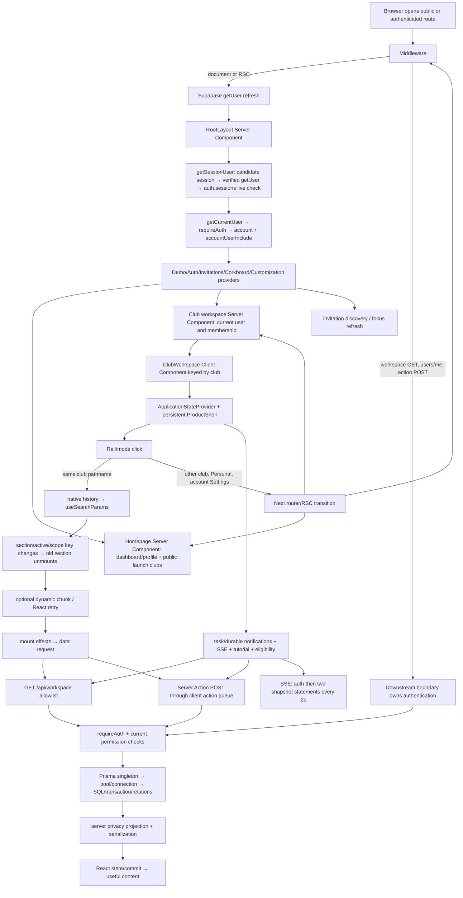

# OutClass navigation performance audit — current review

Updated October 27, 2026. Original audit reference: `3017e01d5b55bc8fb38d4f8fbec4906dd93bf619`. Latest completed experiment/evidence commit: `dd304540aa9a30c64af1b23e21622245c378d98a`. Source references below describe that retained application, not a claim about today's deployed production commit. The review update is on `codex/performance-review-handoff-20261027`.

## Executive summary and current status

This package separates the October 21 investigation, the later local implementation series, and the rejected experiments. **The complete accumulated series is not release-cleared.** The user now authorizes committing independently ready changes to main, followed by resolving the remaining issues. That is not approval to include unresolved experiments. A separately integrated ready subset needs validation against current remote main, which was fetched at `d031364` during this review; no ready-subset merge or deployment has happened in this package.

Phase 1's release is already recorded in main history. Later local work overlaps code/data startup, narrows list projections, bounds page payloads, reduces font preloads and module startup cost, and fences obsolete client reads. Phase 7's full resident-list strategy was superseded by the later fresh-page strategy. Do not cherry-pick every numbered phase together as additive independent improvements.

Phase 13 retains the Phase 12 application and confirms duplicate-startup request reduction, but does not establish consistent tail improvement. Phase 14's speculative Review module preload and Phase 15's query-only Settings→Review handoff are **rejected and reverted**. All 913 final application hashes in Phase 15 equal its baseline, which equals retained Phase 13. Experiment patches and opt-in tests remain available. There is no Phase 15 application speedup in the final source.

## Five biggest confirmed or suspected bottlenecks

| Rank / confidence | Finding and actual evidence | Current source / implication |
|---|---|---|
| 1 — confirmed waiting; root cause unresolved | One accepted constrained candidate cold Review sample has source useful-content time **8,314ms**, identity spans up to **4,221.61ms**, and rounds identity **932.40ms**. Cold click p95 worsens **611.5→1,463.2ms**, n=6/build. Separate diagnostics do not reproduce the stall. | `utils/auth.ts:19` getSessionUser; `:26` remote getUser; `:31` live session; `lib/server-phase-trace.ts:21` request correlation. The span locates waiting, not pure provider execution. Diagnose before retrying adoption. |
| 2 — confirmed startup transfer and first-use cost; exclusive attribution unproven | Retained baseline constrained Settings/Application source p50/p95 **4,341/4,369ms**, n=6, with **517,715 script bytes** and **227,784 font bytes** at the median. Settings Profile cold click **459.5/480.3ms**, warm **150.3/215.3ms**, n=6 each. | `app/layout.tsx:18`, `components/club-workspace.tsx:45`, `components/selected-club-workspace.tsx:14`. Existing module deferral saves Recruiting startup but incurs first-use costs. Network/data/render/frame gaps overlap; do not call them exclusive React time. |
| 3 — confirmed metadata scaling; exact endpoint SQL attribution partial | Native baseline single-reader pipelinePage database span p50/p95 **25.50/30.58ms** at 1,000 versus **107.06/109.19ms** at 5,000, n=10/group. Read-only representative plans execute **10.758ms** at 1,000 and **22.649ms** at 5,000 in the baseline diagnostic. | `lib/pipeline-page-read.ts:17`, `lib/pipeline-metadata-read.ts:23`, `actions/crm.ts:39`. The page hydrates at most 100 summaries on its fast path, but still scans/ranks all eligible metadata. Review/score selectors retain complete hydration. Preserve privacy, collation, facets and snapshot parity. |
| 4 — confirmed redundant Review page request; adoption blocked by tail | Rejected candidate changes constrained cold requests **8→6**, warm **4→3** and click→URL median **128.6→1.5ms** cold. Cold click median **594.6→465.0ms**, warm **264.9→162.0ms**, n=6. The cold tail worsens, so request savings alone do not establish release readiness. | `components/club-settings-workspace.tsx:163`, `lib/workspace-navigation.ts:2`, `components/club-workspace.tsx:280`. Patch: `phase15/EXPERIMENT_APPLICATION.diff`. Direct/new-tab entry and fresh guarded GETs remain necessary. |
| 5 — confirmed background fan-out; contribution to stalls suspected | Retained constrained Settings/Application source captures **60 requests** at median, n=6. The stalled source includes corkboard, invitations and tutorial identity waits. Phase 13 independently reduces source pipeline request snapshots **90→48** and multiple-read preparations **42→0**, without consistent tail improvement. | `components/shell/product-shell.tsx:44`, `contexts/auth-context.tsx`, `components/selected-club-workspace.tsx:48`, `lib/workspace-read.ts:9`. Separate selected work from current support/notification/tutorial work. Preserve genuine Auth refreshes and necessary live updates. |

Numbers in different rows are separate workloads; do not add their durations. Historical hidden-Scheduling/action-queue issues were addressed in Phase 1 and are not asserted to remain unchanged in the current code. See `components/interview-management-tabs.tsx:50`: Scheduling mounts only after selection and then preserves its owner.

## Actual navigation results and sample sizes

The latest complete comparison uses identical synthetic 1,000/5,000 cohorts within pairs, BA then AB order, desktop Chromium 1440×1000, production Next builds and disposable loopback Auth/PostgreSQL. Local and constrained CDP profiles are separate. Constrained means 80ms latency,200,000B/s down,93,750B/s up and CPU4×. Cold/warm describes the destination in fresh browser contexts with warm services; it is not hosted cold-start timing.

| Path / profile / visit | n per build | Retained baseline p50 / p95 / max ms | Rejected candidate p50 / p95 / max ms | Median click requests B→A |
|---|---:|---:|---:|---:|
| Settings/Application→Review / local / cold | 6 | 158.6 /176.4 /176.4 | 95.8 /125.7 /125.7 | 7→6 |
| Settings/Application→Review / local / warm | 6 | 149.3 /166.0 /166.0 | 66.2 /82.0 /82.0 | 4→3 |
| Settings/Application→Review / constrained / cold | 6 | 594.6 /611.5 /611.5 | 465.0 /1,463.2 /1,463.2 | 8→6 |
| Settings/Application→Review / constrained / warm | 6 | 264.9 /463.4 /463.4 | 162.0 /166.2 /166.2 | 4→3 |
| Recruiting→Applicants / constrained /5,000 / warm | 10 | 213.8 /224.1 /224.1 | 215.2 /218.6 /218.6 | 1→1 |
| Applicants→Detail / constrained /5,000 / cold | 10 | 254.7 /286.1 /286.1 | 257.1 /270.1 /270.1 | 4→4 |

Nearest-rank p95 equals maximum for n=6 and n=10; this is small-sample evidence, not a hosted p95 guarantee or statistical significance claim. Phase 15 includes384 main browser outcomes (320 measured/64 warmups),256 feature outcomes (192/64),192 page/search outcomes (160/32) and336 native HTTP reads (280/56). No slow row was replaced. Zero useful-content/page/HTTP errors occurred in accepted main/feature outcomes; aborted and pending transport snapshots remain separately recorded.

Constrained cold Review encoded click bytes p50/p95 are **10,176/12,465→10,175/10,176**; warm **1,342/3,630→1,341/1,342**. These are observed encoded bodies, not all transferred bytes: headers, unavailable aborted bodies and late traffic are absent. The two editor scripts remain7,804 encoded bytes; no cold-script reduction is claimed. Source+click p95 grows **4,980.5→9,777.2ms** cold. That is a per-row sum of two waits excluding intervening preparation/drains, not continuous journey elapsed time.

The JSON retains the original October 21 dataset (1,200 transitions, n=20 per path/condition) and adds `latestReview.records`:92 separately identified groups with actual n, p50, p95, maximum, request timings, missing-metric nulls and raw file/index references. Datasets are never pooled. Pilots, interrupted tests and instrumented diagnostics are not primary performance samples.

## Critical path and architecture

```mermaid
flowchart LR
  C[Click and draft guard] --> N[Same-path history or Next page navigation]
  N --> M[Selected module and data dispatch]
  M --> G[Explicit allowlisted private GET]
  G --> I[Remote verified identity]
  I --> S[Live session and enabled account]
  S --> A[Current club capability and privacy guards]
  A --> D[Prisma transaction and database reads]
  D --> J[Projection, serialization and optional compression]
  J --> R[Current-scope settlement and useful DOM plus two frames]
```



The slow recorded candidate row is `phase15/constrained/size-1000-pair-2-1-A-features-measure/browser-samples.json`, array index19: query URL changes at1.7ms, rounds dispatch starts169ms, response ends1,126ms, scripts finish about1,276ms, useful content arrives1,463.2ms. Rounds server total is956.12ms including identity932.40ms; database spans17.54ms and live-session=6.11ms are nested/overlapping observations, not additive exclusive phases. Source corkboard/invitations/tutorial identity spans are4,221.61/4,199.79/3,895.65ms and overlap. Primary instrumentation cannot isolate provider versus transport/dispatch versus process scheduling in that row.

`phase15/HANDOFF_TIMELINES.json` retains all64 target rows including warmups. `phase15/SERVER_TAILS.json` retains measured source/click tails. The linked full audit retains the original architecture, three historical waterfalls, loader mapping and effect/cache analysis, explicitly scoped to the October 21 source.

## Database findings

Current pipelinePage fast-path metadata is a parameterized application/round/user/profile JOIN with a strict recognized-predicate schema and the original Prisma fallback for unknown predicates. It runs inside the existing freshly authorized Repeatable Read transaction. After canonical privacy-aware ranking, submitted reviews and active assignments are hydrated for at most 100 selected IDs with the original application predicate. Review/rating/score-dependent selectors use the complete summary path. Complete quick-review/voting selection authority is not changed by list paging.

The separate diagnostic cohort contains168 native GETs,56 direct SDK identity observations,32 browser outcomes and four representative read-only plans. All168 native requests correlate with existing trace IDs. Baseline representative plan execution is10.758ms at 1,000 and22.649ms at 5,000; candidate5.557/23.832ms. These are one plan/case, not query distributions or the entire endpoint. No SQL parameter values, rows or credentials are exported.

App-role samples observe up to6 active connections and9 aggregate connections, zero sampled lock waiters. The configured pool limit is8 **per client**; role aggregates include multiple clients/monitor/background work and are not proof of a pool-limit violation or no brief contention. Observable transaction acquisition includes BEGIN/transport; database spans sum elapsed calls and may exceed wall time. Four-reader diagnostic acquisition p95 ranges0.8–2.0ms. Event-loop histogram maxima494.7–559.9ms and completed Auth HTTP maxima57.1–91.7ms do not reproduce or explain the primary multi-second identity stall.

Historical read-only production pg_stat_statements since September21 mixes application, system and test traffic: Club FOR UPDATE n=720 mean405.50ms/max8,260.74ms; FOR SHARE n=12,514 mean19.88ms/max19,092.88ms; Application FOR UPDATE n=213 mean134.21ms/max7,259.63ms. Session-live SQL n=10,672 averaged0.026ms/max0.365ms. No SQL p95 or navigation correlation is available. These histories do not prove that locks caused the current event. No speculative indexes, schema changes, statistics resets or production EXPLAIN ANALYZE are justified.

## Vercel and Supabase regions

**Historical confirmed observation, October 21:** authenticated Vercel Functions dashboard/settings showed iad1/us-east-1; the Supabase connector independently showed us-west-2/PostgreSQL17.6. Evidence: `evidence/vercel-observed.json` and `evidence/database-readonly.json`. Those are not refreshed October 27 telemetry. Current deployed SHA, effective region and runtime pool mode/limit remain to be reconfirmed read-only before attributing today's behavior to regions.

That historical Production12-hour window displayed `/api/workspace` duration average/p75/p95 **1,460/1,580/2,490ms**, active CPU average123ms, approximately1.6K calls. Workspace route duration **2,330/2,590/3,540ms**, active CPU average76ms, approximately3.7K calls. Exact n, p50, maxima and click pairing were unavailable; JSON keeps them null. Route aggregates mix kinds/document/RSC/actions. Low active CPU supports a waiting hypothesis, not a split into provider/pool/SQL/locks.

Source `utils/prisma.ts:10` reuses a module-scoped Prisma client and prefers POSTGRES_PRISMA_URL. Local pool configuration is not deployed configuration. No function/database migration or production setting change was made. A region A/B deployment would be a separately scoped future experiment; it is outside the current no-infrastructure-change work. The historical0.5–1.6s regional sensitivity calculation assumes10–20 serial crossings and50–80ms saved each; neither RTT nor that speedup was measured.

## Security and authorization constraints

Every protected read must retain remote getUser verification of the candidate token; live auth.sessions existence/not_after and revocation; enabled accounts; current club membership, capabilities and suspension; support-session restrictions; anonymous interview/self-review protections; and voting snapshot plus post-snapshot authority. A client epoch is a local stale-work fence, never authorization. React request coalescing is limited to one server request and cannot authorize later requests.

Preserve `private, no-store`, Cookie-sensitive responses and same-origin cookie transport, appropriate Accept-Encoding variance, Demo isolation, mutation atomicity, draft continuity and fresh validation before revealing protected content. No cross-request authorization-success cache or stale private content may be introduced. Writes remain Server Actions. Do not merge guarded voting snapshots into an ordinary cached bootstrap.

## Top ten recommended changes, ordered implementation sequence

| Order | Proposed work / expected impact | Complexity / risk / gate |
|---:|---|---|
| 1 | Correlate the actual constrained multi-request identity stall with Auth create→send→headers→body, process/event-loop timing and database waits. Establish cause before changing behavior. | Medium / low application risk if disposable-only; reproduce the affected burst rather than only isolated GETs. |
| 2 | Integrate independently ready missing-artwork and unused font-preload savings against current main; preserve its newer UI. Phase 10 historically removes200,888 font bytes; logo fallback avoids guessed404s. | Low / low; current-main build, browser/font/artwork checks and relevant tests before commit. No combined-main timing claim until measured. |
| 3 | Retry the preserved query-only Review handoff only after the cold tail is explained. Observed median opportunity129.6ms cold/102.9ms warm constrained. | Low code / medium tail risk; require a fresh full paired protocol and unchanged draft/revocation tests. Current rejected patch stays out. |
| 4 | Reduce Settings first-use module/data/render/frame dependency while preserving Recruiting bundle savings. | Medium / medium; instrument actual stages; rejected Phase 14 preload is not a ready fix. |
| 5 | Bound pipeline metadata/ranking work with canonical privacy/selection/collation/facet parity. | High / high correctness risk; same-snapshot native parity plus1,000/5,000 and realistic histories before changing queries. No speculative DDL. |
| 6 | Resolve resident summaries versus fresh-page interaction policy explicitly, then optimize page/search within that policy. | Medium / high privacy/freshness risk; preserve live checks and report entry plus repeated-interaction cost together. |
| 7 | Coalesce genuinely identical in-flight background resources inside complete current authority scope; inspect remaining pure read actions before allowlisted GET conversion. | Medium / medium; no cross-request authorization reuse, mutation conversion or required live-update suppression. |
| 8 | Narrow/page member invitation history and separate large task targeting catalogs only after measuring populated workloads. | Medium / medium; retain totals, targeting and authority semantics. No fabricated benefit estimate. |
| 9 | Validate mobile/slow-network, active scheduling/voting, multiple clients and realistic review histories with bounded concurrency. | Medium / medium; no pool-size/concurrency increase based on four-reader local probes. |
| 10 | Refresh deployed SHA/region/effective pool settings read-only and pair one hosted slow click with sanitized server phases. | Low investigation / potentially high later deployment risk. Any region experiment needs a separate authorized scope; production configuration remains unchanged. |

These are expected opportunities, not additive speedup promises. The roadmap distinguishes ready-subset integration from blocked candidate changes and later scalability work.

## Changes that should NOT be made

- No remote identity/live-session bypass, token-metadata-only authorization, successful-authorization caching between requests or protected-content flash before fresh required validation.
- No removal of enabled-account, membership/capability/suspension/support checks, anonymous/self-review guards, voting snapshots or live post-snapshot guards.
- No blanket row/advisory-lock removal, transaction-isolation weakening, atomic publication/outbox changes or unbounded Promise.all/pool increases.
- No automatic Redis, new cache library, Edge Functions, schema/index rollout, database region migration, function-size change or complete rewrite.
- No cosmetic benchmark readiness changes, synthetic waits/animations, deleted slow samples, pooled pilots/diagnostics or replacing the failed cold result with a better rerun.
- No deployment of disposable observers, response bodies, cookies, JWTs, SQL parameters, private fixture identities or production environment files.
- No merge of every experimental phase simply because a local test suite passes.

## Information still needed and completion gates

1. Root cause of the primary multi-second identity spans, with request-correlated lifecycle evidence under the actual affected burst.
2. Current deployed SHA/function region, effective Prisma pool endpoint/mode/limit and a paired hosted slow-navigation trace; October 21 observations cannot establish today's deployment.
3. Product acceptance of fresh validation/page/search tradeoffs, and a Settings first-use improvement with no unexplained material tail regression.
4. Mobile/low-end CPU and actual paint/input attribution; production React render duration remains unavailable. DOM plus two frames is a useful-content proxy.
5. Realistic active interview/ballot/review/history workloads and multi-client saturation evidence. Local empty/owner fixtures do not establish production capacity.
6. A current-main integrated ready subset, complete relevant security/browser checks and a separately measured final candidate before broader release clearance.

## Tests, evidence and commands

Completed Phase 15 measured-candidate QA:1,417 ordinary passes/67 gated skips,71 live passes,3 native security/concurrency passes,38 normal signup/Auth/TOTP checks; both production builds, types and lint pass (22 existing warnings). After reverting, the retained source passes1,417 ordinary/63 gated skips and67 live checks again. The four opt-in candidate handoff cases pass against the frozen candidate and skip without their experiment flag. Counts overlap and must not be added. All913 retained source hashes, privacy scans, sleep/host controls and cleanup passed. Prior interrupted ordinary attempts and development failures remain recorded.

This documentation update adds only a read-only evidence summarizer and its tests; it does not introduce a new live probe or collect new timings. It verifies the immutable Phase 15 SHA256SUMS, accepted profile controls, warmup exclusion and complete memberships before emitting92 groups. Run:

```sh
node --test tests/navigation-review-summary.test.cjs tests/navigation-audit-harness.test.cjs tests/navigation-phase15-diagnostics.test.cjs
node scripts/summarize-navigation-review.cjs
```

The first command validates summary quantiles/zero/null handling, whole-profile rejection, actual retained slow-row provenance and existing harness/diagnostic guards. Current update results are recorded in `review-20261027/VALIDATION.json`. It is not a claim to have rerun all live application tests on the documentation branch.

For a new live comparison, use a new disposable copy/output area and the full preparation/build/cohort/ownership controls in `phase15/REPRODUCTION.md`. The completed evidence directories are immutable and collectors deliberately refuse overwriting them. Private fixtures/build snapshots were deleted after cleanup and must be recreated; the commands are not a one-command replay against existing evidence. After provisioning via `node scripts/run-onboarding-e2e.cjs --keep`, seed with `node scripts/navigation-audit.cjs --seed` and `node scripts/pipeline-scale-fixture.cjs 1000` (and an independent 5000 cohort). The guarded lifecycle helper exposes `build`, `snapshot baseline`, `snapshot candidate`, `start baseline`, `start candidate`, and `stop`; configure its private marker/snapshots as the reproduction document describes. Apply `phase15/EXPERIMENT_APPLICATION.diff` only in the disposable experimental copy before freezing candidate, not to main.

Accepted-run entry points, after those prerequisites and fresh output directories are established:

```sh
node scripts/navigation-phase15-study.cjs --profile=local
node scripts/navigation-phase15-study.cjs --profile=constrained
node scripts/navigation-phase15-diagnose.cjs --size=1000 --variant=baseline
node scripts/navigation-phase15-diagnose.cjs --size=1000 --variant=candidate
node scripts/navigation-phase15-diagnose.cjs --size=5000 --variant=candidate
node scripts/navigation-phase15-diagnose.cjs --size=5000 --variant=baseline
```

The opt-in browser experiment needs `OUTCLASS_PHASE15_EXPERIMENT=1` and `OUTCLASS_ONBOARDING_E2E_CONFIG` pointing to the owned loopback configuration. Never substitute production credentials/accounts. Audit actual sleep intervals with `phase15/analysis/audit-power.py <profile-directory>`, and derive tables with the Python analysis scripts listed in `phase15/REPRODUCTION.md`. Native security uses `node scripts/run-disposable-postgres.cjs security`, not a general or production database.

Primary deliverables: [full technical audit](OUTCLASS_NAVIGATION_AUDIT.md), [benchmark JSON](NAVIGATION_BENCHMARKS.json), [optimization roadmap](OPTIMIZATION_ROADMAP.md), and this self-contained handoff. Large raw traces remain under `phase15/local/`, `phase15/constrained/` and `phase15/diagnostics/`; the JSON provides file/index provenance. Original production/DB observations remain under `evidence/`. No report PR is created; any future report PR must remain separate and unmerged unless explicitly authorized.

## Historical audit boundary

The following original report is preserved verbatim as historical evidence. Its dates, source lines, “current” region/runtime observations, recommendations and “no optimization implemented” statements refer only to October 21 and commit3017e01. The current review above supersedes those status statements. Its original20-sample cohorts are not pooled with Phase 15, and the old bottlenecks already addressed by later work are not current unresolved defects.

---

# OutClass navigation performance audit

October 21, 2026 · investigation only · source `3017e01d5b55bc8fb38d4f8fbec4906dd93bf619`.

## Executive summary

OutClass's largest demonstrated production cost is waiting for authenticated server work. The current production Vercel functions run in **iad1 / us-east-1**, while the connected Supabase project is in **us-west-2**. The authenticated production dashboard reports `/api/workspace` function duration **1.46 s average, 1.58 s p75, 2.49 s p95**, versus **123 ms average active CPU**. The workspace route reports **2.33 s average, 2.59 s p75, 3.54 s p95**, versus **76 ms average active CPU**. These are route-level aggregates, not browser click-to-content measurements. The dashboard's rounded invocation counts are approximately 1.6K and 3.7K respectively, over its selected last-12-hours Production window. [Recorded production observations](evidence/vercel-observed.json).

The app compounds those waits. Three Interview Rooms reads written inside `Promise.all` become sequential Server Action HTTP requests. Opening Rooms also mounts the hidden Scheduling workspace, repeats the assigned-room read, and starts availability, coverage and booking-publication requests. Other tabs discard their content on section changes and fetch on mount. Several cold paths load JavaScript before starting their data request, with an approximately 300 ms retry/mount gap visible locally. Pipeline and member resources retain data briefly but still refetch on each mount.

**Confirmed:** cross-region placement; multi-second production server durations with much lower active CPU; local sequential action requests; hidden/duplicate interview reads; keyed section remounts; unconditional revalidation; broad, unpaginated relation reads and substantial pipeline payloads. **Strong hypotheses:** repeated cross-region Auth/SQL round trips and action-queue backlogs explain a significant part of reported five-second navigation. **Unverified:** the exact five-second production click's attribution to Auth, pool acquisition, a particular SQL statement, lock wait, or a specific deployed commit.

The uncontended local production-build fixture does **not** establish reproduction of the reported five-second production transition. Local measurements and current production telemetry are kept separate. Historical locking statements have multi-second maxima, including Club `FOR SHARE` reads, but their traffic cannot be assigned to a particular navigation. A targeted transport/query/region/cache-owner plan is justified; a rebuild, Redis or an Edge migration is not.

## Scope, safety and evidence

No application optimization was implemented. No production records, indexes, schema, query-statistics reset, function configuration, deployment or Git merge were changed. The only production database operations were read-only diagnostics and nonexecuting `EXPLAIN` plans with an absent synthetic UUID. Authenticated browser tests used a reserved disposable local Supabase project, real local Auth/OTP verification and PostgreSQL, and a real Next production build. Fixture creation and existing acceptance tests wrote only to that disposable project. Existing user work in `docs/club-management-skipped-tests.md` was left untouched.

The local browser account owns two synthetic clubs. Each has 61 members, 100 submitted applications with a profile/experience, two rounds, one meeting, one task and one announcement. There are no active room assignments, ballots, applicant answers or evaluation histories. Voting measures opening/closing the empty-session workspace, with its automatic new-session modal handled explicitly; it does not measure an active voting session. Local desktop Chromium uses a 1440×1000 viewport without mobile CPU/network throttling. Node is 26.9.0, Next 15.5.27, React 19.2.0, Prisma 6.19.3. This workstation and Docker stack are not production hardware.

Evidence files contain no cookies, tokens, credentials, response bodies or identifiable production user records. Request arguments and concrete club IDs are stripped. The fixture configuration/passwords remain outside the repository in the runner's protected temporary directory and are not deliverables. No raw authenticated HAR/Playwright trace was exported.

## Architecture and complete lifecycle



| Journey | Actual path and retained state |
|---|---|
| Open OutClass | `app/layout.tsx:76` awaits verified session; authenticated bootstrap calls `getCurrentUser`. Public launch clubs are cached separately. `app/page.tsx` loads authenticated dashboard/profile even when the shared homepage URL also hosts marketing. `HomeEntry` defers the account AppShell bundle (`components/home-entry.tsx:13`). |
| Authenticate/resume | Supabase server/client adapters handle cookies. `getSessionUser` obtains a candidate token, verifies that exact token with `getUser`, and queries `auth.sessions` for user/session/not_after (`utils/auth.ts:18`). Expired tokens can require an extra provider refresh. Normal unchanged accounts are read rather than upserted (`:73`). Support mode follows separate session/target rules. |
| Enter club | Workspace Server Component calls request-cached `getCurrentUser`, checks suspended membership and renders `ClubWorkspace key={clubId}`. AuthSessionBoundary blocks only a known pending identity, not every tab (`components/auth-session-boundary.tsx:8`). Client selection must match the URL before legacy recruiting tools mount (`components/club-workspace.tsx:134`). |
| Switch club/recruiting tabs | `handleClubLink` intercepts same-path links; native history updates search params (`lib/workspace-navigation.ts:2`). `ProductShell` disables same-club link prefetch (`:137`). The section key includes authorization/resource scope, section and active tool (`components/club-workspace.tsx:201`). Standard rail tab changes do not need a new RSC render. Overview-card/tutorial/manual `router.push` paths still exist and should not be assumed identical to rail navigation. |
| Open applicant/member | Member details initially use the directory already in memory, then eligibility controls request a separate club eligibility catalog (`components/availability/interviewer-eligibility.tsx:15`). Applicant drawer initially uses pipeline data, then requests the authorized display and attendance (`components/applicant-intelligence.tsx:14`, `components/recruitment-attendance-summary.tsx:15`). Changing candidate resets these resources. Interview entry has separate exact booking/round/assignment validation and can create a local interview record when actually opened; that mutation workflow was not production-tested. |
| Return to tab | Members/Pipeline can initialize from the mounted parent's 30 s retained data, but both still revalidate. Tasks/Meetings/Announcements remount/refetch. Overview retains matching data while another overview request runs. Dynamic module bytes are reused in the same document; remounting does not necessarily download them again. |
| Recruiting ↔ Club | Same pathname/history and same shell, with different active section/mode. Switching `needsOverview` back to true triggers another overview read. Shell notification effects have stable callbacks and do not rerun solely because `active` changed. |
| Switch club | Workspace switcher calls `router.push`, producing route/RSC work and a new club-keyed workspace/resource owner. Account AuthProvider is in the root layout and normally persists, although changed server bootstrap props can synchronize it. New shell initialization repeats background reads. |
| Return to Personal | Cross-path router navigation returns to `/`; server dashboard/profile work and dynamically loaded personal views are involved. Within an already-open Personal workspace, AppShell uses native history for supported student destinations (`components/app-shell.tsx:95`). |
| Settings | Organization Settings is a same-path section. It retains visited authorized panels while the settings owner remains mounted (`components/club-settings-workspace.tsx:54`); leaving Settings destroys that owner. Account-menu `/settings` is a separate server route and was not part of the scoped Settings tab benchmark. |

Server Actions live in `actions/*`; GET reads are explicitly dispatched in `app/api/workspace/route.ts:40`, with private/no-store responses. `lib/workspace-api.ts` is a Client Component boundary that combines real action proxies, GET adapters and live/Demo domain logic. Its action references are transformed to client proxies; importing them does not bundle Prisma/server implementation code into the browser.

## Performance measurements

The final machine-readable distributions and sample-level request records are in [NAVIGATION_BENCHMARKS.json](NAVIGATION_BENCHMARKS.json), [browser samples](evidence/browser-samples.json), and the supplementary detail/voting files. Cold means the destination has not been opened in a newly loaded browser document/context; it does not mean a cold database or Vercel function. Warm means the destination was opened, left and revisited without reloading. Repeated means alternating visits in one document, including its first destination visit. Browser/HTTP caches are not equivalent to server/resource caches.

Meaningful content is a tab-specific loaded-data predicate followed by two animation frames: a useful paint proxy, not a screenshot-derived paint time. Interactive time records an enabled visible control at that point; no write is invoked to prove interactivity. React commit notifications and CDP ScriptDuration/TaskDuration/LayoutDuration deltas are recorded. Standard production React does not provide trustworthy profiler render durations, so they remain null. Long tasks are observed during click→content. CPU deltas continue through request settling and include background work.

Request body-byte counters come from Playwright `request.sizes()` and exclude HTTP headers; ordinary JSON serialization size is measured separately. These are not a claim about total production wire bytes. Completed non-SSE requests are drained after content to include secondary work. An open notification stream is intentionally excluded from a finite network-completion timestamp.

<!-- LOCAL_MEASUREMENTS -->
Accepted dataset: **1200 transitions/detail openings, 20 paths × 3 conditions × 20 samples**. The representative Members/Applicants/Interviews pass was rerun sequentially with click-relative network event clocks; other local passes are labeled in the JSON. Failed/superseded harness cases are excluded. The largest accepted local transition was 712.6 ms.

| Navigation | Cold p50 | Warm p50 | p95 (cold / warm / repeated) | Blocking operation | Evidence |
|---|---:|---:|---:|---|---|
| Overview → Members | 381 ms | 31.2 ms | 416 / 32 / 32.3 ms | Dynamic Members code → members GET | [20 samples/condition](evidence/waterfall-samples.json) |
| Members → Meetings | 63.9 ms | 64.5 ms | 64.8 / 65.5 / 97.6 ms | listMeetings action | [20 samples/condition](evidence/browser-samples.json) |
| Meetings → Tasks | 381.4 ms | 64.8 ms | 397.5 / 81.4 / 143.4 ms | Dynamic Tasks code → getTaskWorkspace action | [20 samples/condition](evidence/browser-samples.json) |
| Tasks → Announcements | 379.2 ms | 64.6 ms | 396.9 / 113.9 / 443.5 ms | Dynamic Announcements code → getClubAnnouncements action | [20 samples/condition](evidence/browser-samples.json) |
| Announcements → Overview | 63.7 ms | 31.1 ms | 111.6 / 31.6 / 31.8 ms | overview GET; checklist is secondary | [20 samples/condition](evidence/browser-samples.json) |
| Recruitment Overview → Applicants | 406.3 ms | 31.2 ms | 424.6 / 32.7 / 33.5 ms | Dynamic Applicants code → pipeline GET | [20 samples/condition](evidence/waterfall-samples.json) |
| Applicants → Interviews | 449.3 ms | 129.4 ms | 481.2 / 147.4 / 133.2 ms | Dynamic Interview code → three serial visible-room actions | [20 samples/condition](evidence/waterfall-samples.json) |
| Interviews → Decisions | 397.7 ms | 31.3 ms | 415 / 32.2 / 31.9 ms | pipeline GET; retained data on revisit | [20 samples/condition](evidence/browser-samples.json) |
| Decisions → Recruitment Overview | 63.9 ms | 30.8 ms | 164 / 31.7 / 31.8 ms | overview GET; retained overview on revisit | [20 samples/condition](evidence/browser-samples.json) |
| Overview → Settings | 37.7 ms | 31.1 ms | 43.1 / 32.3 / 32 ms | Settings client render from account data; extra reads secondary | [20 samples/condition](evidence/browser-samples.json) |
| Settings → Overview | 81.3 ms | 31.2 ms | 161.5 / 31.8 / 32.1 ms | overview GET; retained overview on revisit | [20 samples/condition](evidence/browser-samples.json) |
| Overview → Recruitment Overview | 33 ms | 31.4 ms | 35.5 / 32 / 31.8 ms | Retained overview + local render | [20 samples/condition](evidence/browser-samples.json) |
| Recruitment Overview → Overview | 36.2 ms | 31.7 ms | 43.4 / 32.4 / 32.1 ms | Retained overview + local render | [20 samples/condition](evidence/browser-samples.json) |
| Applicants → Voting | 89.8 ms | 103.8 ms | 113.7 / 363.8 / 497.4 ms | voting GET (empty-session fixture) | [20 samples/condition](evidence/voting-samples.json) |
| Voting → Applicants | 31.5 ms | 32.2 ms | 32 / 33.1 / 33.7 ms | Close modal; underlying pipeline retained | [20 samples/condition](evidence/voting-samples.json) |
| Applicants → Applicant detail | 128.3 ms | 104.6 ms | 247.1 / 238.9 / 146.8 ms | applicantDisplay GET; attendance/other panels secondary | [20 samples/condition](evidence/detail-samples.json) |
| Members → Member detail | 35.4 ms | 31.4 ms | 40.4 / 32.7 / 33.9 ms | Local directory row; eligibility action secondary | [20 samples/condition](evidence/member-detail-samples.json) |
| Recruitment Overview → Club 2 (default Recruiting) | 129.1 ms | 147 ms | 160 / 163.6 / 196.6 ms | Next RSC/club selection → overview GET | [20 samples/condition](evidence/cross-club-samples.json) |
| Personal Home → Recruitment Overview | 459.1 ms | 459 ms | 477 / 476.9 / 493.6 ms | Next RSC/module entry → overview GET | [20 samples/condition](evidence/cross-club-samples.json) |
| Recruitment Overview → Personal Home | 363.7 ms | 377.7 ms | 394.9 / 383.7 / 387.2 ms | Next RSC/Personal Home module and dashboard data | [20 samples/condition](evidence/cross-club-samples.json) |
<!-- END_LOCAL_MEASUREMENTS -->

Production observations must not be substituted into those local tab distributions:

| Production route | Displayed volume | Duration average / p75 / p95 | TTFB average / p95 | Active CPU average / p95 |
|---|---:|---:|---:|---:|
| `/api/workspace` (all read kinds) | ~1.6K | 1,460 / 1,580 / 2,490 ms | 1,490 / 2,580 ms | 123 / 204 ms |
| `/club/[clubId]/workspace` (documents/RSC/actions) | ~3.7K | 2,330 / 2,590 / 3,540 ms | 2,320 / 3,580 ms | 76 / 222 ms |

The selected dashboard window was Production, last 12 hours, displayed 05:08–17:08 America/New_York. Counts are rounded; exact n, p50 and maxima are unavailable. Different overview/detail widgets displayed different aggregate values, so this report uses the recorded route-detail widgets consistently. A sanitized individual club-path cohort showed p75 4.18 s across a displayed 445 invocations; that still does not identify which tab or action was slow. Hot starts were 97.1% of API requests and 99% of workspace-route requests. Cold starts alone cannot explain broadly slow p75 values.

## Ranked bottlenecks

| Rank / certainty | Problem, exact source | Evidence and root cause | Impact, proposed solution, difficulty and risk |
|---|---|---|---|
| 1 — placement/wait confirmed; attribution strong hypothesis | Remote verified identity + multiple serial SQL phases: `utils/auth.ts:18`, `:42`, `:90`; `utils/prisma.ts:9`; loaders below | Confirmed iad1→us-west-2 placement. Production server wall durations greatly exceed active CPU. Real local loaders issue 4–21 SQL/control statements and 1–2 Auth verifications. SQL historical means are mostly sub-ms. No correlated pool/network spans yet. | Every uncached read pays the chain. Measure a pdx1 preview and reduce serial crossings. Medium overall. Preserve every live security decision and measure browser→function tradeoff. Do not call the regional sensitivity model an observed speedup. |
| 2 — confirmed locally | Read actions serialize: `components/interviews/interview-rooms-list.tsx:36`; `lib/workspace-api.ts:311`, `:337`, `:390` | Three nominally parallel room reads appear one after another in HTTP. Next's installed mutable action queue also serializes reducers in the controlled existing harness. A slow earlier noncritical action can delay a later action's dispatch. | Requests that could overlap become a sum. Move pure reads to the existing explicit GET boundary or a narrow bootstrap. Medium; validate original guards, Demo isolation, no-store and pool headroom. |
| 3 — confirmed | Hidden Scheduling and duplicate room read: `components/interview-management-tabs.tsx:41`; `components/interviews/room-manager.tsx:54`, `:83`, `:90`, `:107`, `:108` | Rooms cold generates 13 requests, warm eight. Five scheduler-related requests include a duplicate assigned-room read, hidden availability/coverage and publication work. | Excess work continues after first room content and can queue ahead of the next tab. Defer panels until selected and deduplicate exact-scope reads. Small–medium; preserve active drafts/live updates. |
| 4 — confirmed remount/fetch; retry explanation strongly supported | `components/club-workspace.tsx:201`; member `:106` and pipeline `:166` effects; dynamic imports at `:14`, `:34`–`:41` | Section/active keys destroy child state; most reads start only after mount. Cold dynamic chunks finish before the delayed effect begins. Installed React retry threshold is 300 ms. Members/Pipeline retain data but revalidate unconditionally. | Warm private data may still be quick, but network/SQL work repeats; uncached sections block on fresh reads. Intent preload + bounded resource owners, retain clean view state only. Medium; retain identity/grant/privacy resets and fresh authorization before revealing protected cached data. |
| 5 — confirmed query shape/payload | `actions/crm.ts:26`, `:54`; `actions/organization-members.ts:120`; `actions/tasks.ts:108`; `actions/applicant-intelligence.ts:22` | 100-applicant list is ~193 KB ordinary JSON/~201 KB wire data and 17 SQL/control statements in the local full-guard probe. Members client pagination fetches entire roster/invitation history. Tasks fetches assignment/targeting relations. | Remote statements, serialization/transfer and large-list growth. Compact list DTOs, server filters/cursors, lazy detail/history. Medium–large; anonymous/privacy/feedback/self-review correctness is critical. |
| 6 — confirmed mechanisms; contention magnitude unmeasured | `components/shell/product-shell.tsx:66`, `:82`; `contexts/organization-invitations-context.tsx:32`; stream `:26`; `actions/communications.ts:61` | Task 60 s, durable 30 s, focus events, SSE initial revision and 2 s DB snapshots. Stable shell avoids per-tab effect restart; cross-route remounts repeat initialization. Notification contexts can cause per-item reads in one transaction. | Background reads and queued actions compete with navigation. One authority-scoped coordinator, event coalescing and batched contexts. Medium; keep timely updates, revocation safety and fallback recovery. |
| 7 — historical waits confirmed; navigation attribution unverified | `lib/club-suspension.ts:4`; `utils/interview-access.ts:5`; `actions/interview-entry.ts:12`/`:27`; write-side transaction helpers | Historical Club FOR SHARE max 19.09 s, Club FOR UPDATE max 8.26 s, Application FOR UPDATE max 7.26 s. Interview read transactions hold shared club/account/member locks and can wait behind writers. No blocked sessions at the first snapshot. | Possible long-tail delays during scheduling/publication/revocation. Correlate lock and acquisition spans; batch N+1 work to shorten transactions. Medium–large. Do not remove security/atomicity locks merely because their cumulative cost is high. |

## Critical-path analysis and request waterfalls

General path: click → immediate history/state update → optional dynamic chunk/React retry → mount effect → request transport (possibly queued) → verified Auth → live session SQL → account/member/suspension checks → loader SQL/transaction and network → projection/serialization → React commits → useful content. Browser network TTFB includes server work and transport; it is **not** a pure server-phase measurement.

<!-- WATERFALLS -->

### Overview → Members

Representative cold sample #12: URL change 0.5 ms; useful content 381.0 ms; enabled-control readiness 381.3 ms; ScriptDuration 21.3 ms through settle. Request start/end offsets are Playwright event-receipt wall times relative to the captured DOM click; event delivery/rounding can differ from Chromium's TTFB/transfer clock. Do not sum these clocks as precise server phases. TTFB includes transport/server work; server-only phases and individual request initiator stacks are unavailable.

| Type / request | Initiator | Start → end | TTFB / transfer | Encoded body bytes | Content dependency |
|---|---|---:|---:|---:|---|
| GET script `/_next/static/chunks/5339.86ceadf4d1aaf32b.js` | Next dynamic import | 2.9 → 32.9 ms | 2.0 / 0.5 ms | 16835 | Tool code/style before mount |
| GET fetch `/api/workspace?kind=members` | Mounted component effect | 312.9 → 360.9 ms | 52.0 / 1.2 ms | 39981 | Required directory |

### Recruitment Overview → Applicants

Representative cold sample #10: URL change 0.3 ms; useful content 406.3 ms; enabled-control readiness 406.7 ms; ScriptDuration 30.6 ms through settle. Request start/end offsets are Playwright event-receipt wall times relative to the captured DOM click; event delivery/rounding can differ from Chromium's TTFB/transfer clock. Do not sum these clocks as precise server phases. TTFB includes transport/server work; server-only phases and individual request initiator stacks are unavailable.

| Type / request | Initiator | Start → end | TTFB / transfer | Encoded body bytes | Content dependency |
|---|---|---:|---:|---:|---|
| GET script `/_next/static/chunks/7789-41f4249d32518cdb.js` | Next dynamic import | 2.8 → 14.8 ms | 1.2 / 0.5 ms | 2979 | Tool code/style before mount |
| GET script `/_next/static/chunks/66.829a606517e52f12.js` | Next dynamic import | 2.8 → 14.8 ms | 2.4 / 1.1 ms | 24283 | Tool code/style before mount |
| GET script `/_next/static/chunks/2637.e1c43e4781be3984.js` | Next dynamic import | 2.8 → 14.8 ms | 1.2 / 0.7 ms | 1713 | Tool code/style before mount |
| GET stylesheet `/_next/static/css/95d50e8373a8c44c.css` | Next dynamic import | 4.8 → 14.8 ms | 1.2 / 0.2 ms | 584 | Tool code/style before mount |
| GET fetch `/api/workspace?kind=pipeline` | Mounted component effect | 314.8 → 372.8 ms | 60.8 / 0.8 ms | 201229 | Required applicant list |

### Applicants → Interviews

Representative cold sample #17: URL change 0.5 ms; useful content 449.3 ms; enabled-control readiness 449.5 ms; ScriptDuration 27.3 ms through settle. Request start/end offsets are Playwright event-receipt wall times relative to the captured DOM click; event delivery/rounding can differ from Chromium's TTFB/transfer clock. Do not sum these clocks as precise server phases. TTFB includes transport/server work; server-only phases and individual request initiator stacks are unavailable.

| Type / request | Initiator | Start → end | TTFB / transfer | Encoded body bytes | Content dependency |
|---|---|---:|---:|---:|---|
| GET script `/_next/static/chunks/8221-adb09f1ceaf37505.js` | Next dynamic import | 2.8 → 38.8 ms | 1.2 / 0.5 ms | 3043 | Tool code/style before mount |
| GET script `/_next/static/chunks/9067.653cccb77d92cce7.js` | Next dynamic import | 2.8 → 38.8 ms | 2.6 / 1.7 ms | 32914 | Tool code/style before mount |
| GET stylesheet `/_next/static/css/de2dc5f4d7fff07b.css` | Next dynamic import | 6.8 → 38.8 ms | 0.8 / 0.3 ms | 974 | Tool code/style before mount |
| GET stylesheet `/_next/static/css/1b6a24993c2bd9fc.css` | Next dynamic import | 6.8 → 38.8 ms | 1.0 / 0.2 ms | 1852 | Tool code/style before mount |
| GET stylesheet `/_next/static/css/3718fdba3d47d048.css` | Next dynamic import | 6.8 → 38.8 ms | 0.4 / 0.6 ms | 507 | Tool code/style before mount |
| POST fetch `actions/interview-entry.ts:getAssignedInterviewRooms` | Mounted component effect | 320.8 → 373.8 ms | 52.5 / 0.4 ms | 86 | Visible Rooms Promise.all barrier |
| POST fetch `actions/interview-kits.ts:getInterviewWorkspace` | Mounted component effect | 373.8 → 404.8 ms | 30.3 / 0.3 ms | 111 | Visible Rooms Promise.all barrier |
| POST fetch `actions/interview-kits.ts:getInterviewRounds` | Mounted component effect | 404.8 → 428.8 ms | 22.8 / 0.3 ms | 179 | Visible Rooms Promise.all barrier |
| POST fetch `actions/interview-rooms.ts:getRoomWorkspace` | Mounted component effect | 428.8 → 476.8 ms | — / — ms | — | Hidden Scheduling; not needed for Rooms |
| POST fetch `actions/interview-entry.ts:getAssignedInterviewRooms` | Mounted component effect | 476.8 → 531.8 ms | 53.8 / 0.5 ms | 86 | Duplicate hidden scheduler read |
| GET fetch `/api/workspace?kind=availabilityOverview` | Mounted component effect | 480.8 → 548.8 ms | 68.0 / 0.7 ms | 52023 | Hidden Scheduling; not needed for Rooms |
| GET fetch `/api/workspace?kind=staffingCoverage` | Mounted component effect | 480.8 → 541.8 ms | 60.8 / 0.5 ms | 114 | Hidden Scheduling; not needed for Rooms |
| POST fetch `actions/interview-booking-publication.ts:getInterviewBookingPublication` | Mounted component effect | 531.8 → 583.8 ms | 50.4 / 0.6 ms | 95 | Hidden Scheduling; not needed for Rooms |
<!-- END_WATERFALLS -->

Ordinary same-club rail navigation in the representative samples sends no document/RSC navigation request and no `/api/users/me` request. A refresh, a different club/path, a router-based secondary link or changed bootstrap is a different path. A broad diagnosis that every tab repeats the root layout/AuthProvider is therefore incorrect.

## Authentication and authorization audit

`getSessionUser` uses `getSession` as a token source, verifies that token remotely, then checks live `auth.sessions` with session/user/not_after. `requireAuth` separately reads the current enabled Prisma account. `requireClubPermission` adds a fresh membership read and, normally, operational-club checks. A typical workspace read thus has one remote `getUser`, one revocation SQL and at least account/member reads before its data. The standard verified session probe in the existing real HTTP suite confirmed one Auth verification and one revocation statement per ordinary request.

React `cache` already coalesces `getSessionUser` and `getCurrentUser` in the same Server Component render. Middleware remains a separate request phase: it skips its own `getUser` for `/api/workspace`, `/api/users/me` and action POSTs (`middleware.ts` ownsAuth branch), while document/RSC requests use middleware refresh plus server verification. `requireAuth` itself is not memoized, so account reads can repeat between guards even when RSC identity is reused. [React cache documentation](https://react.dev/reference/react/cache) restricts that API to Server Components; do not assume it deduplicates nested guards in a GET route handler. The local outside-RSC Voting probe observed two provider verifications and two session checks, matching its explicit pre/post-snapshot guards.

Those Voting checks protect changes during its snapshot (`actions/voting.ts:30`, `:55`). They are not an automatically removable duplicate. Safe refactoring may share immutable verified identity *inside a clearly bounded request* only if revocation/disablement/current-grant checks still occur at their required authority boundaries. Do not cache a successful authorization between requests or remove the post-snapshot guard.

AuthProvider receives `initialUser`, keeps identity across normal tabs, and coalesces concurrent `/api/users/me` fetches by generation (`contexts/auth-context.tsx:46`). It does not automatically call that endpoint on every selected tab. Identity reload occurs on explicit `refreshUser` after relevant mutations or a pending/missing bootstrap. Global user data includes profile, applications and memberships with substantial club fields (`lib/account-data.ts:39`), so initial RSC/account requests deserve payload measurement separately.

## Component lifecycle, effects and caches

| Component/resource | Fetch/reset trigger and cache behavior | Assessment |
|---|---|---|
| ClubWorkspace overview | club/retry/ready/loading/selection/membership/scope/`needsOverview`; keeps matching data | Re-entering Overview refetches; useful retained data may render immediately. Setup checklist can add action work. |
| Members | mount, club, retry; 30 s parent-retained directory; local search/history/page/selection state resets on section key | Revalidation is unconditional, even with initialData. UI pagination does not bound DB payload. Member drawer uses the loaded row while a separate eligibility action loads its controls. |
| Applicants/Decisions | mount, club, revision, round, gender, count toggle; parent retains pipeline 30 s | Query/filter changes can fetch; other local filters/sorting use the full array. Decisions and Applicants remount each other but can share retained pipeline. Reuse must key filters and privacy correctly. |
| Tasks | club/refresh/demo readiness/auth-loading and mount | No tab-level resource reuse; resets loaded state; manager needs full targeting member list. |
| Meetings | club/refresh and mount; audience/time filtering local | Resets meetings/loading. Meeting detail has independent attendance/check-in workflows; navigation-only tests do not invoke writes. |
| Announcements | club-bound reload callback on mount | 50-item read; scheduled history is secondary. Request uses an action transport. |
| Interview Rooms | club/retry/readiness; mount/focus/15 s poll | Three gated reads; rows clear while refreshing. Scheduler is currently force-mounted too. Per-booking lookup loops add scale risk. |
| Scheduling | club/refresh/readiness; round/date coverage; event refresh | Parent keys change with interviewTab; schedule/availability round navigation intentionally preserves its draft scope. Hidden child panels still fetch. |
| Applicant display | club/app/candidate revision/evaluation refresh/session/preview config | Deliberate privacy reset and live authorized projection. Attendance is another request; these can overlap as GETs. |
| Voting | club/session/demo/user scope; 5 s serialized polling | Existing in-flight coalescing and disposal prevent overlapping/stale results within that reader. Empty-session timings exclude ballots. |
| Settings | authorized visited panels remain mounted until leaving Settings or explicit discard/invalidation | Useful existing pattern; some retained hidden panels can continue effects. Do not retain dirty/private panels across authority changes. |
| Global providers/shell | root Auth/Invitations persist; shell usually persists across query-only tabs; club/path changes remount workspace shell | No evidence of a full provider remount on every ordinary tab. Stable notification callbacks avoid active-tab-triggered restarts. |

The resource scope includes live/Demo, user, club, membership/grants and pipeline/application/privacy revisions (`components/club-workspace.tsx:112`). Scope mismatch immediately hides resources and generation checks discard late responses. It is component-local rather than a cross-user global cache. Support-session changes trigger a full reload through `SupportSessionSync`, whose background checks are another read source. Existing caching still depends on when authority changes are learned; extending TTL or using unrestricted stale-while-revalidate would not meet immediate-revocation requirements.

Prefer improving this owner with canonical filter keys, in-flight deduplication, bounded resource retention and explicit authority epochs first. SWR/React Query could reduce maintenance complexity later, but neither replaces authorization, fixes SQL shape or eliminates the action queue. No new cache library is an automatic recommendation.

## Query performance and Prisma

The supplementary original-loader probe uses real local Supabase Auth, session revocation SQL and Prisma/PostgreSQL. It adapts only framework cookies/redirects and support-mode resolution and runs outside the RSC dispatcher. It excludes Next middleware, HTTP dispatch, client queue/render time and the production pooler. Two warm-up invocations precede 20 samples per loader. SQL/control counts include BEGIN/SET/COMMIT and batched relation queries, not just top-level ORM calls. [Raw loader evidence](evidence/loader-samples.json).

<!-- LOADER_TABLE -->
| Original loader | n | Local p50 / p95 / max | SQL/control statements | Auth verifications | Ordinary JSON bytes |
|---|---:|---:|---:|---:|---:|
| overview | 20 | 24.11 / 37.79 / 51.52 ms | 11 | 1 | 684 |
| members | 20 | 29.01 / 36.17 / 36.88 ms | 12 | 1 | 36449 |
| pipeline | 20 | 27.1 / 57.6 / 58.08 ms | 17 | 1 | 193216 |
| tasks | 20 | 23.96 / 50.73 / 59.99 ms | 16 | 1 | 18856 |
| meetings | 20 | 21.09 / 27.48 / 31.34 ms | 4 | 1 | 353 |
| announcements | 20 | 22.35 / 46.47 / 83.14 ms | 6 | 1 | 205 |
| voting | 20 | 47.32 / 85.58 / 94.74 ms | 21 | 2 | 479 |
| applicantDisplay | 20 | 25.35 / 48.63 / 56.71 ms | 19 | 1 | 1231 |
| assignedRooms | 20 | 23.88 / 63.43 / 99.83 ms | 17 | 1 | 2 |
| interviewWorkspace | 20 | 24.83 / 28.72 / 31.2 ms | 13 | 1 | 31 |
| interviewRounds | 20 | 25.79 / 68.43 / 103.21 ms | 13 | 1 | 112 |
| roomWorkspace | 20 | 23.99 / 70.05 / 74.86 ms | 13 | 1 | 5299 |
<!-- END_LOADER_TABLE -->

Members uses an interactive transaction: `actorFor(..., false)` avoids its exclusive write locks but still reads current account/member, club, all members and relations, invitations/latest deliveries, and identifiers. `Promise.all` inside that transaction cannot turn its single connection into multiple concurrent SQL connections. Pipeline's repeatable-read transaction first reads rounds, then all applications and many batched relations. This is relation fan-out, not one query per applicant in the measured 100-row fixture; assigned interview entries **do** have per-booking loops for assignments, panels, records and colleagues.

The shared overview loader also waits for club, meeting, personal work, review count and recruitment groups together (`actions/club-overview.ts:13`). RecruitingOverview consumes club/membership/recruitment, so meeting/work/review queries are unnecessary for that view even though the common `Promise.all` waits for them. No individually slow overview SQL was established here; this is confirmed avoidable dependency breadth. Hidden Scheduling's availability overview was about 52 KB in the empty-assignment fixture, illustrating that the eight warm Interview requests carry more than trivial status responses.

Current production `pg_stat_statements` observations since September 21:

| Statement family | Calls | Mean / stddev / maximum | Interpretation |
|---|---:|---:|---|
| advisory transaction lock | 30,312 | 257.99 / 227.08 / 938.06 ms | Historical contention/serialization lead; not assigned to navigation. |
| Club FOR UPDATE | 720 | 405.50 / 1,186.00 / 8,260.74 ms | Lock acquisition can wait; index creation would not eliminate such waits. |
| Club FOR SHARE | 12,514 | 19.88 / 314.60 / 19,092.88 ms | Read-side shared lock can wait behind an exclusive writer. |
| Application FOR UPDATE | 213 | 134.21 / 726.39 / 7,259.63 ms | Mutation/interview transaction lead, not proven list-read cost. |
| session-live EXISTS | 10,672 | 0.026 / 0.009 / 0.365 ms | Database execution is tiny; says nothing about remote RTT/acquisition. |
| common full User lookup | 78,748 | 0.087 / 1.068 / 199.004 ms | Mostly cheap execution; extra remote queries still have latency. |
| sampled Application relation shape | 1,340 | 0.384 / 1.029 / 20.377 ms | No evidence that this ordinary execution alone explains seconds. |

These are cumulative mixed-role/query-shape aggregates, not production-user latency distributions. SQL p50/p95 cannot be reconstructed from mean/stddev/max. Dashboard catalog queries were also among the most expensive entries; they are not dashboard-tab application queries. Existing historical docs/tests show extensive test traffic, but these statistics do not identify individual test versus real-user calls. No statement statistics were reset.

The first activity snapshot had zero blocked sessions; a later one showed four idle-in-transaction postgres sessions, with no request attribution or duration conclusion. `max_connections` was 60 and `track_io_timing` off. These are insufficient to prove pool saturation or I/O as a cause. Table estimates were small: about 53 Users, 45 Clubs, 34 ClubMembers and 24 Applications; sequential scans on such small tables are not automatically index defects.

Live indexes already cover club/member, club/status/round applications, active round ordering, invitations and delivery history, task review queues and notification account/time reads. Nonexecuting plans using an absent synthetic club/user selected a membership index and a small Application sequential scan/sort. They are not plans for an actual populated club or the full Prisma relation query. No missing-index recommendation is made solely from those plans. The existing PGlite audit was rerun as supplementary synthetic query-plan evidence; its in-memory/owner timings are not remote PostgreSQL latency. [Sanitized database snapshot/plans](evidence/database-readonly.json).

## Deployment, region and connections

The Supabase connector independently confirmed OutClass in `us-west-2`, PostgreSQL 17.6. Vercel connector project discovery succeeded, but team-scoped detail returned 403 and exposed no authorize-team tool. The existing authenticated browser dashboard provided current settings and Production telemetry: Fluid enabled, Standard 1 vCPU/2 GB, selected **iad1**, with **pdx1 unselected**, and the live Functions page explicitly displayed Region IAD1. This improves on historical repository region notes; it is not inferred from the account's location or an edge response header.

`utils/prisma.ts:9` creates a module-scoped extended client, prefers POSTGRES_PRISMA_URL, and falls back to the schema DATABASE_URL. Development additionally reuses a global client. There is no per-request disconnect pattern in these loaders. Production worker-instance count, effective connection limit/acquisition timeout and actual runtime URL/pool mode were not accessible through the connector. A redacted local configuration inspection found DATABASE_URL using the West-region Supavisor host on port 5432 with no explicit pool options; this describes local configuration only. Supabase documents session and transaction pool modes separately in [its connection guide](https://supabase.com/docs/guides/database/connecting-to-postgres).

An iad1→pdx1 preview is a high-priority experiment because many dependent operations cross the country. If 10–20 effective serial crossings each lose 50–80 ms of round-trip overhead, the arithmetic saving is 0.5–1.6 s. **Neither RTT nor that saving was measured from Vercel in this audit.** Query count is an upper-bound clue, not an exact crossing count: concurrent top-level queries overlap, relation/transaction statements serialize, and Auth adds a separate service hop. Include users' browser→function latency before deciding. [Vercel region configuration documentation](https://vercel.com/docs/functions/configuring-functions/region). No settings were changed.

## JavaScript, hydration and rendering

The guarded local production build succeeded. Next reports **510 kB first-load JS** for the workspace, versus 105 kB shared baseline. Gzip calculations from actual emitted files and route manifests are retained in [bundle evidence](evidence/bundles.json); these are asset measurements, not field transfer/hydration promises. Prominent initial chunks include a 62.2 KB gzip common chunk, two chunks containing live/Demo logic at 55.0/40.5 KB gzip, and a Supabase client chunk at 54.2 KB gzip. The PDF chunk is 129.3 KB gzip and is not in the initial workspace route manifest.

`lib/workspace-api.ts:2`–`:78` combines many real action proxies, Demo domain modules, schemas and transformations. This contributes reachable client code; server action implementations/Prisma do not thereby become client code. Inspection of the selected emitted chunks found action references and Demo/client logic, not PrismaClient. The chunk-name/content inspection is not a full webpack module-weight attribution, so exact bytes attributable to each dependency or duplicate dependency are unmeasured.

Dynamic Members, Tasks, Announcements, Applicants and Interview tools do defer chunks until first use, as the network records show. Their mount-only reads create a code/data waterfall. Revisited chunks are reused rather than fetched on every remount. The React production scheduler installed with Next contains `globalMostRecentFallbackTime + 300 - now()` at `node_modules/next/dist/compiled/react-dom/cjs/react-dom-client.production.js:10695`; the observed approximately 300 ms pre-effect gaps and much faster same-document revisits strongly support this retry mechanism. No React-internal modification is proposed.

The root uses self-hosted Next font assets (local Caslon plus build-generated DM Sans). Representative settled tab waterfalls did not require image/font downloads; their timing is not assigned the server delay. Initial image/font timing on real production content remains unmeasured. No Supabase Storage upload/download or Resend/SMTP delivery was on the tested tab-read critical paths; those separate file/mutation/outbox workflows must not be blamed without their own request evidence.

The 100-applicant UI renders/filters/sorts a full array; members page the UI over a full response. No target-mobile profile, React profiling build or thousands-row browser render was measured. Pagination/projection should precede automatic virtualization recommendations. CPU/commit results are descriptive local measurements, not proof that the entire initial JS cost is harmless on weaker devices.

## Background and notification work

ProductShell task and durable effects are keyed by identity/demo/support status and stable synchronization functions, so normal tab selection does not itself restart them. Tasks refresh on mount/focus/change and every 60 s. Durable notifications refresh on mount/focus/change, every 30 s, and SSE revisions. SSE starts with an initial revision, uses two DB snapshot statements every two seconds, and closes after roughly 45 s before reconnecting. One uninterrupted active stream therefore implies roughly 60 snapshot statements/minute plus authentication/reconnect and other notification reads. The stream does not hold one Prisma transaction/connection during each two-second sleep.

Invitation discovery is shared at the root and refreshes on focus and visibility; it can also bind a verified school identity through its existing workflow, which is why it was not repeatedly benchmarked against a real production account. SupportSessionSync checks `/api/platform/view-as` on mount/focus/pageshow/visibility and every 30 s. Workspace switchers perform eligibility reads; desktop/mobile presentations can mount separate instances. Tutorials add scoped reads. These matter particularly on new shell mounts and rapid navigation while queued read actions remain pending.

`getDurableNotifications` fetches a bounded page but then resolves current booking/availability/panel/assignment contexts in an interactive transaction, with partial assignment-context deduplication. It can produce per-row relation work and keeps the transaction through those reads. Batching/coalescing is appropriate; disabling live updates or retaining unauthorized old notification content is not.

## Target feasibility and estimated impact

| Engineering target | Assessment |
|---|---|
| Visited tab p50 <150 ms | Already reached for several local retained-data paths. Feasible for small views with warm modules/state; protected cached content still needs the required fresh authority check. Current cross-region latency prevents a blanket guarantee. |
| Uncached tab p50 <500 ms | Local results show this is plausible for small data. Production requires shorter remote chains, region validation, bounded data and fewer queued reads. |
| Major directory p50 <800 ms | Plausible with pagination/projection and nearby server/database. Large invitation/evidence payloads need a separate dataset. |
| Initial authenticated dashboard p50 <1.5 s | Local cold-context overview entry measured 215.8 ms p50 / 274.2 ms p95 and Personal Home 454.9 / 462.1 ms, n=20 each, with warm server/DB. Production still needs correlated initial-entry/account/dashboard measurements. Route aggregates are not that measurement. No production guarantee. |
| Tab p95 <1 s | Not met by current production API/server-route aggregates. Region + transport + query-shape changes are the most credible path; lock/contention tails require their own acceptance tests. |

Hidden-work removal should reduce request/backlog load; concurrency changes can replace sums with the longest independent request; region proximity can reduce repeated RTT; compact DTOs bound data and CPU costs. These gains overlap and must not be added into a fabricated overall percentage. The detailed dependencies, risk and sequence are in [the roadmap](OPTIMIZATION_ROADMAP.md).

## Evidence gaps

1. A correlated authenticated production browser trace of the reported five-second transition, exact deployed commit and exact request kind/action. Read-only telemetry was available; production browser navigation against real records was not used as a fixture.
2. Per-request Vercel Auth, connection acquisition, Prisma statement/network, transaction lock-wait and serialization spans. Route averages cannot assign their difference from CPU to a single dependency.
3. Exact production invocation n, route-kind p50/p95/max, server action name/method splits, and active-user versus synthetic/test traffic classification.
4. Actual effective production database endpoint/mode, worker pool settings, pool occupancy, idle transaction ownership and a same-region comparison. Local env is not deployment evidence.
5. Active voting histories, booked/concurrent interviews, large invitation histories, multi-university and thousand-applicant browser datasets; revoked/support-session performance cohorts.
6. Production React render/commit durations, isolated low-end/mobile hydration/CPU and field click→content instrumentation. Commit count is not render time.
7. Full module-level bundle attribution and duplicate-dependency cost. No new dependency or infrastructure recommendation is justified from a filename alone.
8. Absolute paint/input latency: the local harness uses explicit DOM/animation-frame and enabled-control proxies. Initial table-row/list and modal predicates do not assert every secondary panel has finished.

## Reproduction and validation

Run commands sequentially, avoiding overlapping benchmark runs for a controlled CPU comparison. The existing setup runner validates its dedicated project/loopback ports, applies migrations only there, verifies Auth/OTP/MFA and builds `.next-publish`; it does not use the normal application database target. It runs local acceptance tests before keeping the fixture available.

```sh
node scripts/run-onboarding-e2e.cjs --keep
node --test tests/navigation-audit-harness.test.cjs
node scripts/navigation-audit.cjs --samples=20
node scripts/navigation-audit.cjs --only-voting --samples=20
node scripts/navigation-audit.cjs --details --samples=20
node scripts/navigation-audit.cjs --cross-club --samples=20
node scripts/navigation-audit.cjs --initial --samples=20
node scripts/navigation-audit.cjs --waterfalls --samples=20
node scripts/navigation-loader-audit.cjs
node scripts/performance-audit.cjs > /tmp/outclass-static-performance.json
node --test tests/navigation-audit-harness.test.cjs tests/performance-regressions.test.cjs tests/workspace-navigation.test.cjs tests/workspace-reliability.test.cjs tests/serialized-workspace-read.test.cjs
git diff --check
```

The first local fixture attempt rejected two synthetic seed values at existing database constraints (interview offices and round type); the harness was corrected to valid application values. Failed partial fixtures remained solely in the disposable project. The first Voting close path did not account for the automatic nested new-session dialog; its incomplete cases are recorded as harness failures and superseded by a corrected dedicated pass, not reported as app latency/errors. Some supplementary local runs overlapped on this workstation; aggregate CPU/tail distributions are not an isolated hardware capacity test. Dedicated exact-click waterfalls are identified separately in the evidence. No SQL values, tokens or real account details were exported.

Cross-workspace adapters were corrected to wait for the destination club/path and the actual switcher's default Recruiting destination, rather than matching an old shell/Overview. Member-detail readiness was corrected to permit its own sheet. Those superseded groups are excluded. One exploratory, superseded Personal→Recruiting cold run observed approximately 4.31 s; its detailed request record was overwritten during adapter iteration, so it is preserved here as an unclassified observation, not silently treated as a clean production reproduction or assigned to a particular cause. Final accepted distributions use the corrected complete pass.

Validation completed:

- Guarded local production build passed; all 38 real local Auth/OTP/MFA/PostgreSQL/HTTP acceptance checks passed, zero failures/skips.
- All corrected final cohorts completed: 1,200 accepted transitions/detail openings, 40 initial entries, and 240 measured original-loader reads (plus two warm-ups per loader). Supplementary synthetic PGlite/action-queue tooling completed.
- Focused tests passed: 26 tests, zero failures/skips, including two diagnostic percentile/redaction checks. New script syntax, artifact whitespace, local report/evidence links, JSON distributions/sample counts and credential-pattern checks passed. No full repository test rerun beyond the fixture runner/focused checks is claimed.
- Cleanup stopped the verified loopback Next listener on port 3107 and only the reserved `outclass-onboarding-e2e` Supabase project with no backup. Its local configuration/password/fixture files and certificate key were removed. Other local Supabase projects were not targeted; production was unchanged. `.next-publish` remains an ignored local build artifact.

The build/setup and test log summaries are preserved in [validation evidence](evidence/validation.json). Four requested deliverables were created; no PR, release or merge was performed.
