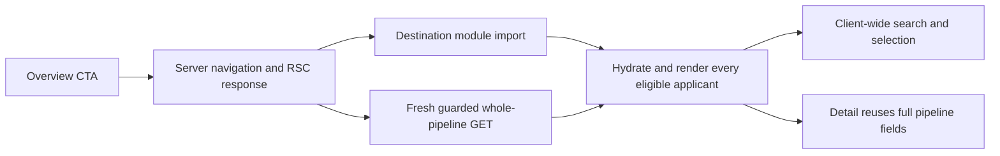
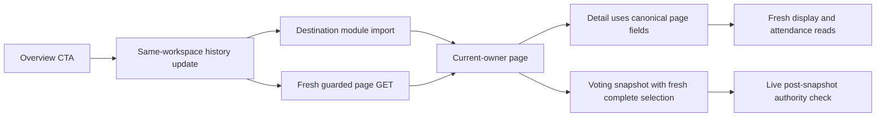

# Current repair and retained failures

Current main is `0a40de7c`. The second source attempt is `d0d6f277`, application
digest `df971d7995db833ce7730354b270c88e0d26091758bc7153163cfbeb33860bb7`.
All 34 frozen gates pass in the complete current-source matrix. The first revision 2 attempt
is retained under `revision-2/attempt-1/`; revision 1 remains sealed at `b2d8883d`.

The original held experiment added a page/selection/detail dependency even
when the visible page already held all authorized applicant information.
The repaired contract hydrates canonical details for the selected visible
page once, then reuses them within that current authorized owner. Complete
page coverage also supports local filtering without additional page reads.
It is actual unscoped coverage, without an applicant-count threshold. Fresh
reads continue to authorize remotely and supersede previous coverage even
when their results are denied or obsolete.

The first revision 2 source removed duplicate round relation reads from page
metadata and stopped reranking an exact server response on initial render.
All one-applicant primary gates passed. In the constrained comparison, cold
directory p50/p95 changed from 554.7/655.8 to 524.9/568.7ms; cold detail changed
from 235.3/313.5 to 228.6/266.7ms. These results describe that previous source
and VM, not the new source or hosted performance.

It still failed warm voting: local p50 205.1 to 229.6ms (limit 225.1), and
constrained p50/p95 544.1/584.2 to 586.8/685.6ms. Both builds used one voting
request. The candidate constructed a necessary fresh complete selection in
the voting snapshot, but redundantly queried each application's round relation
after the snapshot had already fetched club rounds. The second attempt shares
the page's canonical metadata reader with selection and supplies a complete
same-snapshot privacy map. Archived rounds remain internal; controls and gender
eligibility stay active-round-only. A missing map entry fails closed. Submitted
review, self-review, privacy-aware ordering and global selection semantics stay
canonical; all voting writes and post-snapshot live checks are byte-identical
to current main.

The first attempt also recorded a 33.7-second constrained one-applicant review
journey. Its entry stage took 29.6 seconds. The route request finished near
118ms, while applicant chunks and the pipeline request started around 29.5
seconds. This is delayed destination startup after a server navigation, rather
than a slow pipeline database request. The trace alone does not identify the
browser/router scheduling mechanism or establish an Auth transport cause.

The Overview's All applicants link had not adopted the existing same-workspace
navigation helper already used by the dock. The second attempt uses that helper
and disables unused prefetch for this query-only destination. The history entry
and modified-link behavior remain; the destination still makes one fresh
guarded page read. Desktop/touch integration checks that read and the absence
of an unused same-workspace RSC navigation.

Current-main entry dependency:

Repaired entry dependency:

| Operation | Current main | Repaired source |
|---|---|---|
| Initial directory | Unused same-workspace RSC dependency, then parallel code/full guarded pipeline read | History update, then parallel code/bounded guarded page read |
| Detail and on-page switch | Reuse full pipeline fields; fresh Applicant Display and attendance | Reuse current page fields; the same fresh Display and attendance reads |
| Global query changes | Filter/sort the full hydrated client dataset | Filter locally only with actual complete coverage; otherwise a fresh bounded page GET with globally correct metadata |
| Quick-review selection | Derive IDs from the full client dataset | Reuse actual complete coverage or request fresh canonical complete IDs |
| Voting setup | Fresh voting workspace snapshot plus candidates from the earlier full client pipeline | One fresh voting workspace request also builds complete candidate IDs inside that snapshot, followed by live authority revalidation |
| Closed setup polling | Fresh session/history state | Fresh session/history state without an unnecessary candidate-selection scan |
| Page boundary | All rows already hydrated/rendered | One fresh guarded adjacent page adopted once, with no duplicate detail GET |

At 100 applicants the current complete-review workload retains ten guarded
requests per sample, matching main. At 1000/5000 the bounded workflow normally
adds three necessary guarded reads for global search/reset and complete quick
review selection. Their work and wire costs remain inside the measured full
journey. Background route/prefetch traffic, cancellation and missing byte sizes
are separately retained in raw request totals rather than hidden or treated as
known zero-byte responses.

The earlier strict observer's missed character-data notifications were fixed
before revision 2. The new long entry tail is retained without subtracting any
time. The current observer additionally records bounded existing sanitized
read-cause events and browser long tasks. No production identity/token/content
telemetry is collected, and the historical uncontrolled production Auth stall
remains unattributed. Global metadata/ranking/selection is still O(N); the wire
detail projection and rendered directory page remain bounded.
