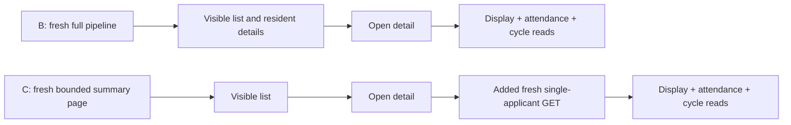
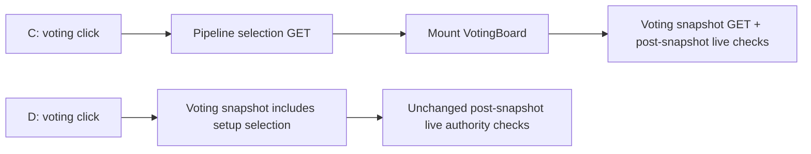
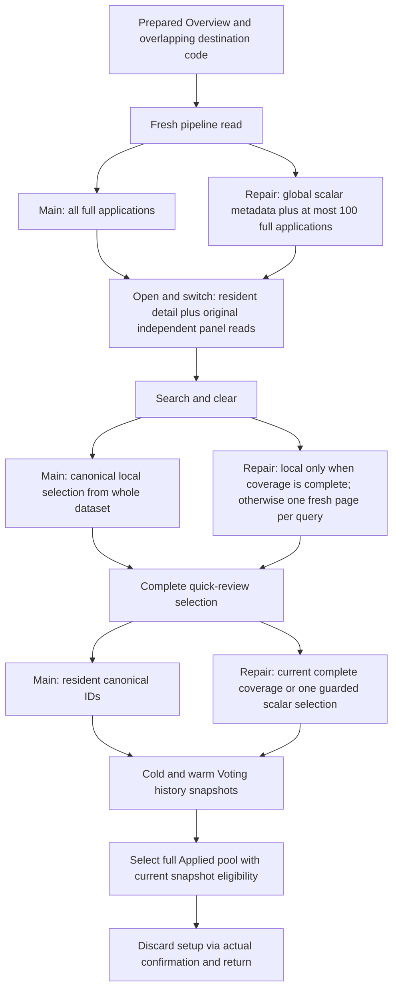

# Request dependencies and the release blocker

Initial integration base: `f2192e02e5e218537f4dda8a4333aecab1602993`.
Latest integration/comparison base: `6e793dea0bd45052fa444749b26d432ae93392cd`.
Measured historical B: `78402ee611f46b8764898250e46b6dcc8dab7654`.
Held C: `375a00d54d95f24e7d600a56218b9bf8040a7937`.
The October 28 decision on diagnostic commit `980522d7` supersedes historical
claims about resident summaries, raw SQL metadata and Settings experiments.
The initial baseline differed from measured B by PR 89's loading feedback.
Main later incorporated the dock fix, persistent live voting rooms, current
layouts, contextual loading and explicit live-room read budgets. The repair is
rebased preserving those changes. The request chains below describe the held
experiment and the retained applicant/voting-history console. New persistent
live rooms are not a performance claim of this repair.

## Confirmed causes

B reads every complete application before showing Applicants. Opening a detail
uses that authorized projection and mounts three independent resources:
`applicantDisplay`, factual attendance and recruitment-cycle choices. They have
separate purposes and guards. Switching applicants remounts these resources.
Searching/sorting ordinary retained data is local. This is inexpensive at one
applicant and very expensive at 5,000.

C's page is at most 100 **summaries**. `usePipelineApplicant` adds a fresh
`pipeline(applicationId)` request on every detail opening; the three original
panels mount only after it resolves. This is a real extra critical-path read,
not a list → metadata → selection → detail chain. Metadata is internal to the
page transaction. Complete selection is not needed for an ordinary detail.

At one applicant, the historical extra GET raises detail-window requests 3→4.
Its identity p95 was 383.76ms and server-total p95 461.97ms, overlapping spans;
the 649ms click tail cannot be exclusively attributed to either. The extra
median wait remains without that outlier. At 100, the old supplementary journey
adds a detail read and a server search read, usually 9→11 window requests.
Those are component/data-contract dependencies, not proof of an Auth defect.

C's voting wrapper waits for `loadSelection` before mounting `VotingBoard`.
Only then does the board start `getVotingWorkspace`. The snapshot operation
already owns live session/member/candidate authority and reads rounds. Setup
therefore pays two serial guarded requests, typically 1→2 on cold entry.

## Repaired contract

The existing visible page (100 rows) is the hydration bound for **every** cohort.
One guarded Repeatable Read response ranks the whole eligible cohort, hydrates
only those IDs through the canonical detail projector, and returns one copy of
each selected application. Opening or switching an applicant on that page uses
these fields and mounts the original three independently authorized resources.
A page boundary fetch hydrates the next visible page once and hands it to the
existing owner. Dashboard single-applicant previews keep an explicit fresh read.

This deliberately trades some of C's minimal summary bytes for removal of the
later dependency. The acceptance experiment must verify both entry and the
complete journey. It does not revert to loading a whole large cohort.

`coverage.complete` means the actual unscoped response contains the entire base
dataset for its mode. The same owner can derive canonical search/filter/sort
results locally from that dataset. It is a coverage fact, not an authorization
decision or a size threshold selected from benchmarks. A new visit, account,
effective actor/support mode, Auth epoch, membership/privacy context or mutation
revision invalidates it. Starting a new guarded operation also supersedes it,
even if that operation later fails or becomes obsolete. A denial cannot be
escaped by clearing the filter.

## Operation map

| Operation | Required information / blocking work in D |
|---|---|
| Initial list | Fresh authority → all canonical scalar ranking metadata → bounded full hydration → exact page/counts/facets |
| Detail on current page | Current owner + already projected application; original display/attendance/cycle reads overlap |
| Switch detail | Same page: no pipeline read; boundary: one fresh page, consumed once |
| Search/filter/sort | Covered complete dataset: local canonical selector; otherwise one guarded page; gender/count queries always guarded |
| Pagination | Scoped cursor, canonical global ordering and counts; new guarded snapshot per page |
| Complete selection | Covered dataset: canonical IDs; otherwise guarded scalar selection, full review metadata only when a selector observes it |
| Bulk/quick decision | Advisory selection; original fresh capability, expected-status and transactional publication guards; refreshed canonical page after write |
| Decisions/rejected | Same bounded contract with explicit mode and global decision facets |
| Voting | One voting GET supplies canonical setup IDs inside its own read-only Repeatable Read snapshot; unchanged live post-snapshot checks |
| Voting writes | Original POST Server Actions, row/advisory locks, expected revisions, eligibility and immutable histories |

Ordinary round filtering also keeps the complete base metadata for facets and
base totals; only the existing gender operation scopes the database predicate
to a round. The same selector now behaves identically for a complete local
dataset and a larger server page. Live parity includes temporarily moving an
application into the second round and restoring it after the check.

Sorting review/score-dependent selections still reads complete review metadata.
Default global ranking remains O(N), with no raw SQL join, new index or schema
change. This is an explicit follow-up cost, not a claimed constant-time endpoint.

The live parity test exposed nondeterministic nested answer ordering between
large and bounded Prisma relation plans. Both detail readers now use explicit
question-order/ID, evaluation-time/ID, experience-ID and booking-time/ID ordering;
the complete projection comparison remains exact rather than ignoring arrays.

## Evidence boundaries

Historical accepted evidence is 808 measured browser outcomes/184 warmups and
140 measured capacity requests/28 warmups. The **entire** first supplement,
including successful rows, remains excluded for actual sleep events. New runs
have separate source/fixture/build/protocol records and must not be pooled with
those historical groups. See `BENCHMARKS.json` and `RELEASE_DECISION.md` for the
eventual measured recommendation; passing correctness is not performance proof.

## Current complete-review dependency graph

At 100, both variants make ten guarded workspace reads and 19 total observed
requests per strict local journey. The repair's complete page supplies search
and quick-review selection without new transport. At 1,000 and 5,000, D makes
three additional meaningful guarded reads compared with main's resident path:
search page, clear-search page, and complete scalar selection. The first page
cannot determine arbitrary matches or all eligible IDs outside its 100 records.
The new query also supersedes earlier coverage; returning to the unscoped query
must not revive data after a denied or obsolete guarded operation. These reads
are intentional correctness/authority dependencies, not duplicate detail or
component-remount reads. Local 1,000 request count is 19→22. At 5,000 main's
longer measured window also overlaps genuine existing notification, view-as,
communications and voting polls; its 44–47→22 total count is not evidence that
those background systems were removed. All requests remain in the raw rows.

The Applied-pool operation remains a separate current voting snapshot. Combining
it with a normal pipeline response would lose its transactional authority.
Initial voting setup consumes the selection already in its own snapshot;
closed-setup polls omit selection, open setup polls refresh it, and explicitly
reopening conceals previous eligibility until that exact new read settles.
