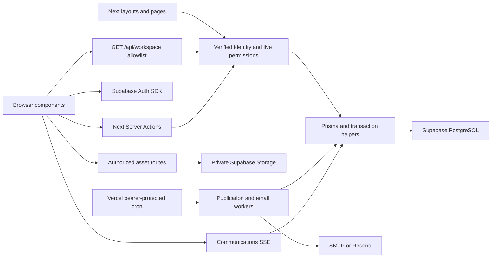

# OutClass data-flow map

Stage A snapshot: commit `03571d5d2275f2899373193a7cd2fbb404a3eb73`, 2026-10-18. The [AST inventory](evidence/source-inventory.json) enumerates 626 source files, 44 page modules, 25 route handlers and 266 exports across 56 action files. This map covers the business boundaries; the inventory preserves each module's imports, calls, ORM operations and source hash. An inventory entry is not a claim that every dynamic path was executed.

| Page / workflow | Component | Server / API | Database operation and tables | Authorization boundary |
|---|---|---|---|---|
| `/` personal dashboard | `HomeEntry`, `AppShell`, `StudentDashboardView` | `app/page.tsx`, `actions/applications.getStudentDashboardData`; subsequent `studentDashboard` workspace read | Own `Application`, `ApplicationAnswer`, `InterviewBooking`; visible `Event`/`EventAttendance`; own official panel assignments | `requireAuth`; `studentId=user.id`; membership/public-event predicates; panel visibility helper |
| Every authenticated route: account and organization selection | `AuthProvider`, shell | `app/layout.tsx` → `getCurrentUser`; `/api/users/me` | `User`, `StudentProfile`, own applications, ACTIVE `ClubMember`, related `Club` | Verified provider user, database disabled check; **Club scalar overexposure confirmed** |
| Explore/discovery | `ExploreView`, club cards | `lib/workspace-api` → `directory` → `actions/club-directory` | Cached public `Club` allowlist, active `PipelineRound`, required `ApplicationQuestion`; fresh published `Event` | Public data only; discoverable and unsuspended club filters; **no campus-specific filter** |
| `/club/[clubId]` profile | `PublicClubPage`, `ClubProfileView` | `getPublicClub` | Public fields from `Club`, rounds/questions and public events | Public profile; unsuspended club filter. Individual profile supports direct links to undiscoverable clubs; confirm this intended product policy |
| `/saved-clubs` | `SavedClubsView`, `CorkboardProvider` | `getCorkboard`, `setCorkboardClub` | Own `CorkboardClub` → public club projection | `requireAuth`, `userId` from session; saves do not grant membership |
| Personal application editor/tracker | `ApplicationStateProvider`, application views | `getStudentApplications`, `saveApplicationDraft`, `submitApplication` | `Application`, current/answered historical `ApplicationQuestion`, `ApplicationAnswer`, `StudentProfile`, first active `PipelineRound` | Authenticated student; own application key; server-owned attachment paths; club lock, DRAFTING predicate and optional expected-answer conflict check |
| `/applications/[applicationId]/decision`, tracker offers | `DecisionLetter`, offers controls | `communications.getDecisionLetter`, `recruitment-offers.respondToOffer` | Own `Application`, immutable `DecisionLetter`, linked `ClubInvitation`, notification | Owner predicate; current decision/version and offer validity; transactional membership creation |
| `/interviews/book`, personal interviews | `BookingLinkPage`, scheduling views | `interview-rooms.getApplicantSchedule`, `reserveInterview`, `cancelRoomBooking`; legacy `scheduling` adapter | Own `Application`, `PipelineRound`, `InterviewRoom`, `InterviewSlot`, `InterviewBooking`, panel publication/availability records | Authenticated applicant; invited status, club/round binding, publication snapshot, future slots, staffing and conflict checks; serialization locks |
| `/settings/availability`, availability requests | `MyAvailability`, `DashboardRequests` | `actions/availability`, `availability-schedules` | `UserAvailability`, `InterviewRoundParticipation`, `ScheduledCommunication`, own notifications | Self-owned availability; scoped club/round membership; manager grants for requests; publication worker rechecks sender |
| `/settings/interviews` | `MyPanelSchedule` | `official-panel-schedule` → official panel helper | Published schedule version/slot, booking-managed assignments | Own member/user identity; only current official assignments |
| `/meetings`, `/meetings/[id]`, `/check-in` | `MeetingWorkspace`, `MeetingCheckIn` | `actions/meetings`; `events` compatibility adapter | Prisma `Meeting` maps to SQL `Event`; `EventAttendance`, `MeetingCheckInToken` | Public recruitment visibility or ACTIVE club membership; manager/attendance capabilities; hashed/expiring QR token and own check-in |
| `/corkboard`, explore events | `CorkboardView`, `PublicEventBoard`, `SmartEventCard` | `actions/campus-events` | `Event`, `EventPublication`, `EventFlyer`, `SavedCampusEvent`, `EventRsvp` | Public approved publication predicates; self-owned saves/RSVP; capacity/deadline checks; approval requires platform authority |
| Club workspace overview | `ClubWorkspace`, overview | `overview` workspace read → `club-overview.getClubWorkspaceOverview` | `Club`, next `Event`, own `TaskAssignment`, scoped task-review count, non-draft `Application.groupBy` | ACTIVE club membership; counts depend on capabilities and anonymous-review visibility |
| Club applicants and analytics | applicant pipeline/review views | `pipeline` read → `crm.getClubPipeline`; `applicantDisplay` read | `Application`, `PipelineRound`, `StudentProfile`/`Experience`, answers, evaluations, panel assignments/bookings; aggregates | Club membership plus identify/review capability; explicit anonymous projection; submitted evaluation and self-review restrictions; repeatable-read snapshot |
| Applicant status / round moves | review controls, voting board | `crm.setApplicationStatus`, `moveApplicantRound`; `recruitment-management` | Scoped `Application`, recruitment cycles, decisions, offers, audit and notification rows | Live permissions rechecked under club lock; expected status/round/version; foreign IDs rejected |
| Recruitment configuration | `RoundSettings`, screening controls, cycle editor | `club-settings`, `recruiting-rules`, `recruitment-management` | `PipelineRound`, `ApplicationQuestion`, `RecruitingRule`, `RecruitingRuleFlag`, `RecruitmentCycle`, `Club` | Independent application/recruitment/identify capabilities; archived round guards, revision checks |
| Interview scheduling / panel assignment | `InterviewManagementTabs` → `RoomManager`, availability overview, proposal controls | `interview-rooms`, `availability`, `panel-proposals`, `panel-publication`, `interview-booking-publication` | Rooms/slots, participation/global availability, proposals, schedule versions, assignments, booking snapshots, audit | Scheduling/owner grants; explicit president approval; global publication serialization; transaction-time permission, availability and conflict checks |
| Interview kits and live interview | `ClubInterviewKitSettings`, `InterviewWorkspaceView`, submitted reviews | `interview-kits`, `interview-entry`, `evaluations`, `interview-collaboration` | `PipelineRound.interviewKit`, `InterviewRecord`, `Evaluation`, `InterviewCollaboration`, `InterviewPresence`, `InterviewInvitation`, `InterviewMove` | Explicit member offices/panel grants; immutable question snapshot; own drafts; closing/submission visibility; optimistic revisions and audit |
| Interview access/moderation | `InterviewAccessSetup`, resume moderation | `interview-access-setup`, `interview-resumes` | `InterviewPanelAssignment`, immutable `InterviewResumeDocument`, annotations/revisions | Club/round/applicant binding, revocation, non-self review, author/moderator permissions; private snapshot bytes |
| Club tasks / assignments | task workspace views | `actions/tasks` | `ClubTask`, `TaskAssignment`, `TaskFile`, `ClubMember`, notification rows | `tasks.manage` for management, active assigned member for submissions; every bulk target checked; former work retained |
| Club members / CSV / ownership | `OrganizationMemberships`, member-management and onboarding components | `organization-members`, `club-access`, `club-onboarding`, `roster-import` | `ClubMember`, `ClubInvitation`, `SchoolIdentity`, `SchoolIdentifierType`, `RosterImport`/`RosterImportRow`, delivery/audit rows | Current club authority; cannot grant capabilities actor lacks; identity and school composite keys; last-owner protection; verified invitation recipient |
| `/invitations/[id]`, personal organization invitations | `InvitationResponse`, `OrganizationInvitationsProvider` | Invitation page, `getOrganizationInvitations`, acceptance/decline actions | Identity-bound `ClubInvitation`; verified `SchoolIdentity`; membership upsert | Verified current mailbox, trusted server metadata proof, active school mapping, invited identity; recipient cannot self-assign identity metadata |
| Club announcements / notifications | `ClubAnnouncements`, inbox/bell, preferences | `actions/communications`, `recipient-groups`, schedule actions | `ClubAnnouncement`, recipient groups/entries, `UserNotification`, preference, outbox/delivery, `ScheduledCommunication` | `meetings.manage` plus audience authorization; immutable recipient snapshot; own inbox predicates; idempotency keys |
| Live notification refresh | notification provider/hooks | GET `/api/communications/stream` → `communicationsSnapshot` | Four database operations per approximately 2-second tick; user/account, inbox aggregates, authorized conversation revision | Auth once at open; disabled user checked each tick; private/no-store; only revision/unread count streamed; support streaming denied |
| Direct messaging legacy actions | retained compatibility exports | `startClubConversation`, `listClubConversations`, other message actions | These exports reject before database/email; historical conversation revision query remains in SSE | Feature disabled in existing source; do not describe it as a working user workflow |
| `/settings/profile`, account | unified profile, account settings | `actions/profile`, `/api/auth/logout`, recovery routes | Own `StudentProfile`/`Experience`; auth provider sessions; admin elevation revocation | Session-owned user ID, strict schemas and path ownership; computing ID derived from email; conflict snapshots on section writes |
| Profile/application documents | profile/upload and resume controls | `uploadProfileFile`, `/api/resumes`, `/api/application-attachments`, `/api/profile-photos`, `/api/recruiting-resumes`, `/api/interview-resumes` | Saved profile/answer/snapshot references + private Storage buckets | Server derives ownership; own saved resume or context-specific authorized reader; anonymous/revocation checks; signed URLs or no-store byte proxy |
| Club artwork and event/decision assets | asset editor, flyer/letter rendering | `club-assets`, `event-flyers`, corresponding API routes, `decision-letter-assets` | `Club` references, `EventFlyer`, private Storage, `EventFlyerDeletion` | Validated raster bytes; server-derived club paths; authorized editor or explicitly public/published reference; cleanup queue |
| `/club-claims/[clubId]`, organization requests | `ClaimForm`, ownership-request controls | `club-directory.requestClubClaim`, `organization-onboarding`; platform claim approval | `ClubClaim`, claim proof, club/membership/invitation and immutable audit | Verified claimant; existing claim/club state; elevated platform approval or scoped owner process; transaction locks |
| `/platform`, section routes, clubs, claims, events, school requests | admin console components | `admin-workspace`, `platform-admin`, `admin-clubs`, `platform-organization-onboarding`, `school-requests` | Platform allowlist/grants/elevation, all relevant scoped domain tables, settings/reports/audit | Server allowlist + active `PlatformAdmin` + MFA + independent session-bound elevation. Sensitive writes use fresh checks and transaction-time validation |
| Platform view-as | admin view-as page and banner | `/api/platform/view-as`, platform/support helpers | Opaque hashed `PlatformViewSession`, `AdminElevation`, `AuditLog`, effective-user operations | Real actor and effective target separated; no target auth tokens; cannot impersonate privileged users; per-operation audit; support authority checked at commit where wrapped |
| Public university interest form | `SchoolRequestForm` | POST `/api/school-requests` | `SchoolRequest` | Same origin, honeypot, bounded body; database-serialized global/hour and per-email/day limits; never grants identity or membership |
| Signup/login/OTP/OAuth/recovery | auth panels / password recovery | Supabase browser Auth; `registerStudent`; `/auth/microsoft`, `/auth/callback`, recovery API | Supabase `auth.*`; `handle_new_user` trigger; app identity synchronization | Verified provider user/confirmed UVA email; safe local redirects; normal login distinct from admin elevation; recovery isolated from visitor session |
| Cron publication / email | No browser page | Three `/api/internal/*` handlers, `scheduled-communications`, delivery workers; Vercel every minute | Durable scheduled intent, user notifications, invitation/notification delivery; row leases and idempotency | Independent constant-time bearer secret; current publisher authority and recipient policy; provider calls outside business transaction; bounded leases/retries |
| `/preview`, demo mode | demo context/store and adapters | Authorized demo endpoint + bundled fictional data; optional `PlatformContent` seed | Browser demo store; seed read only | Allowlisted verified presenter + demo cookie; live reads/writes blocked; support sessions cannot enable demo; sample artwork separately protected |

Public informational/design pages (`/about`, `/uva`, request-school landing, design system) do not have private domain queries beyond shared layout identity resolution. Redirect-only legacy routes (`/interviews`, `/decisions`, `/vote`, `/club/[clubId]/tasks`, `/settings`) forward into the same guarded workflows. Metadata routes use public projections/caches.

The architecture has one primary database path: server-side Prisma plus explicit authorization. Supabase clients provide Auth and Storage, not a second browser CRUD architecture for application tables. There are several transport and projection paths: RSC, GET workspace allowlist, direct Server Actions, asset routes, demo adapters and legacy compatibility actions. The duplicated account projection, multiple invitation adapters and legacy scheduling exports deserve focused consolidation only after contracts/tests exist. No application Supabase `.from(table)` CRUD or Supabase Realtime `.channel()` subscriptions were found; current live updates are SSE and polling.

Shared caching is confined to public directory/launch/sitemap data. React `cache()` deduplicates identity/current-user resolution within a render request. Workspace reads explicitly use `no-store`; client workspace resources are keyed by identity/club/permission scope. Private cache leakage was not reproduced. Public caching still needs invalidation coverage for launch-consent and discovery changes; the launch cache has a separate 300-second TTL.
